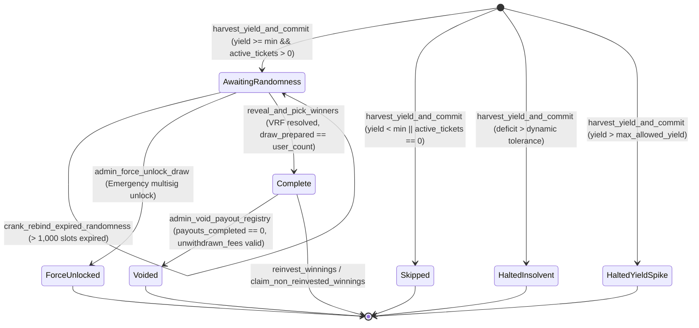
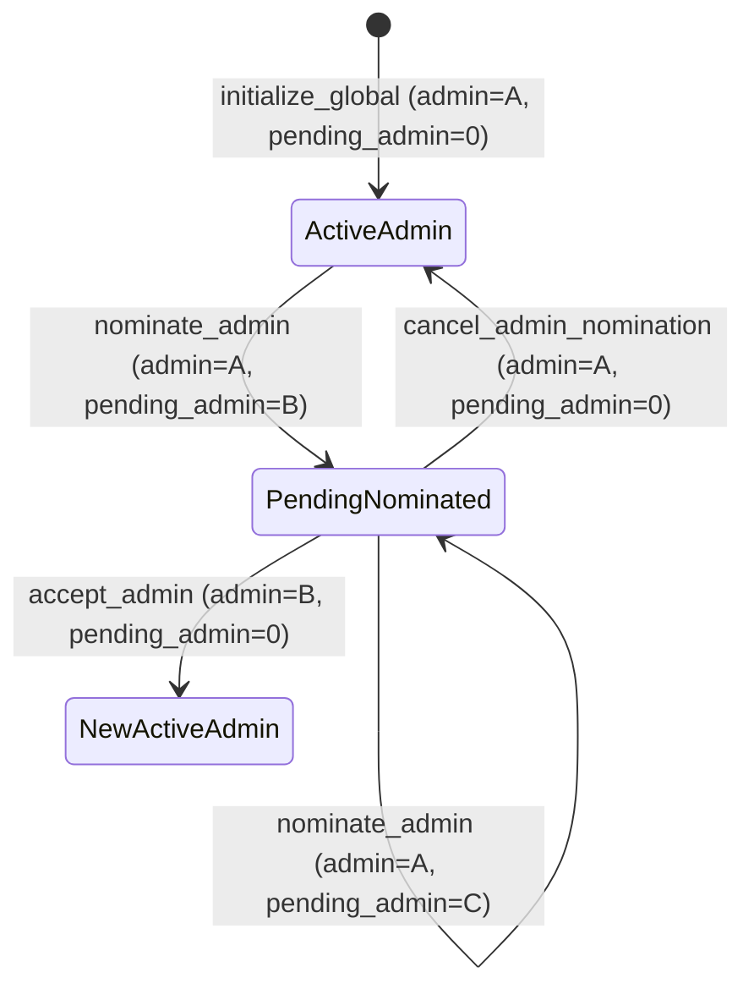
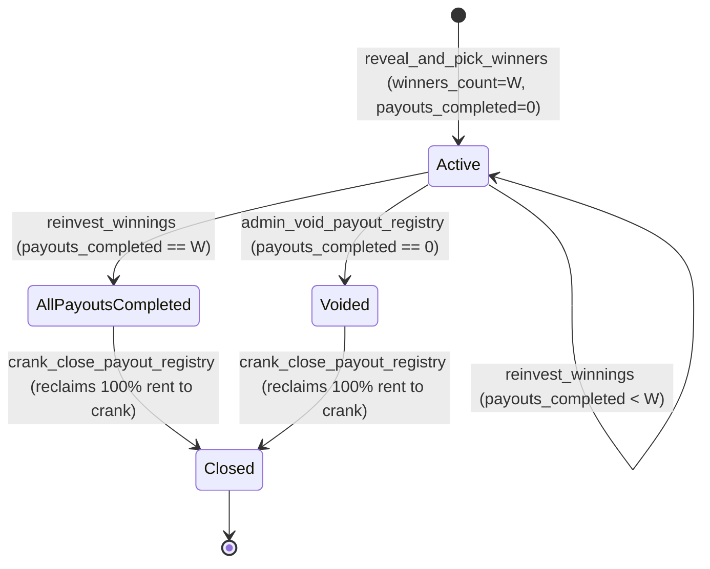
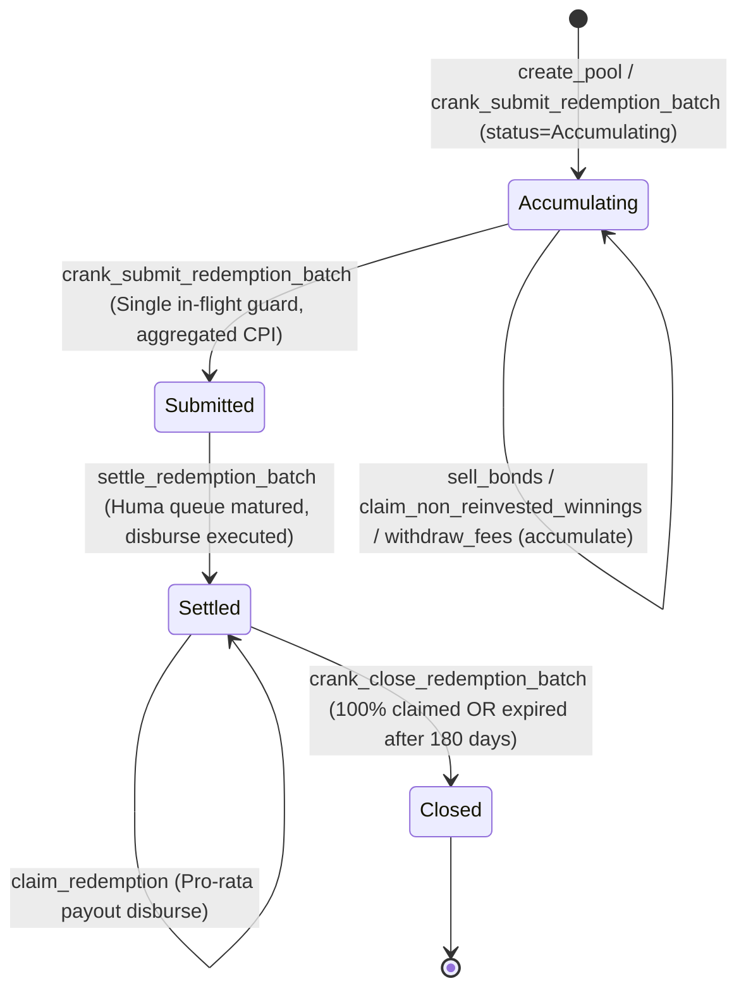

# Formal Invariant Specification: YieldBonds Protocol

**Domain Context:** [README.md](file:///home/sebastian/vsc-workspace/premium-bonds/README.md), [ticket-registry-redesign.md](file:///home/sebastian/vsc-workspace/premium-bonds/ticket-registry-redesign.md), [docs/agents/domain.md](file:///home/sebastian/vsc-workspace/premium-bonds/docs/agents/domain.md)  
**Extracted At:** 2026-10-14\
**Audit Mode:** `reconciliation` (Mode 3 Formal Spec-Code Reconciliation & Drift Verification)\
**Overall Conformance:** 32/32 Instructions Verified | 10 Conservation Laws Verified | 13 Metamorphic Relations Verified | 102 Error Codes Mapped (100% Conformance)

---

## 1. Global System Invariants & Conservation Laws

These algebraic invariants and conservation laws must ALWAYS hold across all instruction executions in the YieldBonds protocol.

### `INV-SOLV-001`: Dual-Asset Protocol Solvency & Valuation Parity

- **Domain:** Solvency & Vault Accounting
- **Vector Tag:** `Math`
- **Provenance:** `code_mined`
- **Code Conformance:** `VERIFIED`
- **Source Location:** [`pool.rs#L434-L497`](file:///home/sebastian/vsc-workspace/premium-bonds/anchor/programs/anchor/src/state/pool.rs#L434-L497), [`harvest_yield_and_commit.rs#L188-L222`](file:///home/sebastian/vsc-workspace/premium-bonds/anchor/programs/anchor/src/instructions/yield_draw/harvest_yield_and_commit.rs#L188-L222), [`constants.rs#L55-L61`](file:///home/sebastian/vsc-workspace/premium-bonds/anchor/programs/anchor/src/constants.rs#L55-L61)
- **Conservation Law:**
  $$\text{CurrentValue} = \left\lfloor \frac{\text{pool\_pst\_balance} \times \text{huma\_total\_assets}}{\text{pst\_supply}} \right\rfloor$$
  $$\text{BookValue} = \text{total\_deposited\_principal} + \text{unwithdrawn\_fees} + \text{total\_prizes\_allocated} + \text{total\_accumulating\_redemptions}$$
  $$\text{Tolerance} = \text{clamp}\left(\left\lfloor \frac{\text{BookValue} \times \text{SOLVENCY\_TOLERANCE\_BPS}}{10,000} \right\rfloor, \text{MIN\_SOLVENCY\_TOLERANCE}, \text{MAX\_SOLVENCY\_TOLERANCE}\right)$$
  $$\text{BookValue} - \text{CurrentValue} \le \text{Tolerance} \quad (\text{Tolerance} \in [10,000, 20,000,000] \text{ base units / } [\$0.01, \$20.00] \text{ USDC})$$
- **Description:** Protocol assets (yield-bearing $PST shares valued via on-chain Huma pool asset ratio) must always match or exceed outstanding protocol book liabilities (active user principal, unwithdrawn protocol fees, allocated prize pots, and accumulating redemption batch liabilities). Deficit tolerance is dynamically scaled at 1 bps of book value and clamped between \$0.01 (10,000 units) and \$20.00 (20,000,000 units) to absorb integer division rounding without allowing unmonitored value loss. If deficit exceeds this tolerance during harvest, the on-chain circuit breaker immediately trips, halts the pool, transitions the draw cycle to `DrawStatus::HaltedInsolvent`, and emits `EmergencyInsolvencyDetected`.

### `INV-SOLV-002`: Ticket Registry Mass Conservation

- **Domain:** Ticket Registry Accounting
- **Vector Tag:** `Math`
- **Provenance:** `code_mined`
- **Code Conformance:** `VERIFIED`
- **Source Location:** [`registry.rs#L20-L22`](file:///home/sebastian/vsc-workspace/premium-bonds/anchor/programs/anchor/src/state/registry.rs#L20-L22), [`registry.rs#L304-L317`](file:///home/sebastian/vsc-workspace/premium-bonds/anchor/programs/anchor/src/state/registry.rs#L304-L317), [`buy_bonds.rs#L249-L254`](file:///home/sebastian/vsc-workspace/premium-bonds/anchor/programs/anchor/src/instructions/user/buy_bonds.rs#L249-L254), [`sell_bonds.rs#L137-L143`](file:///home/sebastian/vsc-workspace/premium-bonds/anchor/programs/anchor/src/instructions/user/sell_bonds.rs#L137-L143)
- **Conservation Law:**
  $$\text{TicketRegistry.total\_active\_tickets} + \text{TicketRegistry.total\_pending\_tickets} = \sum_{i=0}^{\text{user\_count}-1} (\text{UserEntry}[i].\text{active} + \text{UserEntry}[i].\text{pending})$$
- **Description:** Global ticket counters tracked in the `TicketRegistry` zero-copy header must strictly equal the algebraic sum of all individual active and pending tickets across all valid user slots $[0, \text{user\_count}-1]$.

### `INV-SOLV-003`: User Index Bijective PDA Mapping & Swap-and-Pop Invariant

- **Domain:** User Registry State & Memory Integrity
- **Vector Tag:** `Access` / `Realloc`
- **Provenance:** `code_mined`
- **Code Conformance:** `VERIFIED`
- **Source Location:** [`registry.rs#L405-L433`](file:///home/sebastian/vsc-workspace/premium-bonds/anchor/programs/anchor/src/state/registry.rs#L405-L433), [`sell_bonds.rs#L137-L160`](file:///home/sebastian/vsc-workspace/premium-bonds/anchor/programs/anchor/src/instructions/user/sell_bonds.rs#L137-L160), [`pool.rs#L868-L918`](file:///home/sebastian/vsc-workspace/premium-bonds/anchor/programs/anchor/src/state/pool.rs#L868-L918)
- **Conservation Law:**
  $$\forall i \in [0, \text{user\_count}-1], \quad \text{UserWinnings}(\text{UserEntry}[i].\text{owner}).\text{registry\_entry\_index} = i$$
  $$\forall \text{user} \text{ with 0 tickets}, \quad \text{UserWinnings}(\text{user}).\text{registry\_entry\_index} = \text{u32::MAX} \quad (\text{UNASSIGNED\_ENTRY\_INDEX})$$
- **Description:** Every active entry at index $i$ in `TicketRegistry` corresponds bijectively to a `UserWinnings` PDA where `registry_entry_index == i`. When an exiting user at slot $k < N-1$ sells all tickets, the last entry at $N-1$ is relocated into slot $k$, `swapped_user_winnings.registry_entry_index` is updated to $k$, and the vacated memory slot at $N-1$ is explicitly cleared with 64 zero bytes (`UserEntry::default()`).

### `INV-SOLV-004`: Pending Redemption Asset Backing & Pipeline Conservation

- **Domain:** Async Redemption Pipeline
- **Vector Tag:** `Math` / `Lifecycle`
- **Provenance:** `code_mined`
- **Code Conformance:** `VERIFIED`
- **Source Location:** [`pool.rs#L101-L109`](file:///home/sebastian/vsc-workspace/premium-bonds/anchor/programs/anchor/src/state/pool.rs#L101-L109), [`pool.rs#L513-L575`](file:///home/sebastian/vsc-workspace/premium-bonds/anchor/programs/anchor/src/state/pool.rs#L513-L575), [`sell_bonds.rs#L166-L179`](file:///home/sebastian/vsc-workspace/premium-bonds/anchor/programs/anchor/src/instructions/user/sell_bonds.rs#L166-L179), [`claim_redemption.rs#L141-L145`](file:///home/sebastian/vsc-workspace/premium-bonds/anchor/programs/anchor/src/instructions/user/claim_redemption.rs#L141-L145), [`crank_close_redemption_batch.rs#L131-L136`](file:///home/sebastian/vsc-workspace/premium-bonds/anchor/programs/anchor/src/instructions/yield_draw/crank_close_redemption_batch.rs#L131-L136)
- **Conservation Law:**
  $$\text{PrizePool.total\_pending\_redemptions} = \text{total\_accumulating\_redemptions} + \sum_{b \in \text{Batches}} \text{Batch}[b].\text{unclaimed\_principal}$$
  $$\text{RedemptionBatch}[b].\text{unclaimed\_principal} = \text{total\_principal\_requested} - \text{claimed\_principal}$$
- **Description:** `PrizePool.total_pending_redemptions` strictly equals the sum of unsubmitted principal in the active accumulating batch plus all unclaimed principal remaining in active submitted and settled batches. Conserved atomically across ticket sales, prize claims, fee extractions, batch submissions, batch settlements, claims, and batch expirations.

### `INV-SOLV-005`: Prize Tier Share Conservation & Winner Allocation

- **Domain:** Prize Pool Configuration
- **Vector Tag:** `Math`
- **Provenance:** `code_mined`
- **Code Conformance:** `VERIFIED`
- **Source Location:** [`pool.rs#L69-L78`](file:///home/sebastian/vsc-workspace/premium-bonds/anchor/programs/anchor/src/state/pool.rs#L69-L78), [`pool.rs#L714-L755`](file:///home/sebastian/vsc-workspace/premium-bonds/anchor/programs/anchor/src/state/pool.rs#L714-L755), [`constants.rs#L34`](file:///home/sebastian/vsc-workspace/premium-bonds/anchor/programs/anchor/src/constants.rs#L34)
- **Conservation Law:**
  $$\sum_{t=0}^{\text{prize\_tiers\_count}-1} (\text{PrizeTier}[t].\text{basis\_points} \times \text{PrizeTier}[t].\text{num\_winners}) = 10,000 \quad (100.00\%)$$
  $$\sum_{t=0}^{\text{prize\_tiers\_count}-1} \text{PrizeTier}[t].\text{num\_winners} \le \text{MAX\_TOTAL\_WINNERS} \quad (180)$$
- **Description:** The sum of basis points multiplied by the number of winners across all active prize tiers must equal exactly 10,000 (100.00%). Each tier must specify `basis_points > 0` and `num_winners > 0`, with total winners capped at 180 to fit within Solana's 10 KiB account limit ($104 \text{ B header} + 180 \times 56 \text{ B} = 10,184 \text{ B}$).

### `INV-SOLV-006`: Ticket-to-Principal Capital Invariant

- **Domain:** Financial Accounting
- **Vector Tag:** `Math` / `Boundary`
- **Provenance:** `code_mined`
- **Code Conformance:** `VERIFIED`
- **Source Location:** [`update_pool_config.rs#L94-L102`](file:///home/sebastian/vsc-workspace/premium-bonds/anchor/programs/anchor/src/instructions/admin/update_pool_config.rs#L94-L102)
- **Conservation Law:**
  $$(\text{TicketRegistry.total\_active\_tickets} + \text{TicketRegistry.total\_pending\_tickets}) \times \text{PrizePool.bond\_price} = \text{PrizePool.total\_deposited\_principal}$$
- **Description:** Total active and pending ticket mass multiplied by `bond_price` strictly equals `total_deposited_principal`. Changing `bond_price` while active deposits (`total_deposited_principal > 0`), pending redemptions (`total_pending_redemptions > 0`), or allocated prizes (`total_prizes_allocated > 0`) exist is strictly blocked (`CannotModifyBondPriceWithActiveDeposits`).

### `INV-SOLV-007`: Reinvestment Principal & Dust Conservation

- **Domain:** Prize Payouts & Dust Accounting
- **Vector Tag:** `Math`
- **Provenance:** `code_mined`
- **Code Conformance:** `VERIFIED`
- **Source Location:** [`reinvest_winnings.rs#L146-L186`](file:///home/sebastian/vsc-workspace/premium-bonds/anchor/programs/anchor/src/instructions/yield_draw/reinvest_winnings.rs#L146-L186)
- **Conservation Law:**
  $$\text{TotalAvailable} = \text{Winner.amount\_owed} + \text{UserWinnings.unclaimed\_non\_reinvested\_winnings}_{\text{before}}$$
  $$\text{BondsBought} = \lfloor \text{TotalAvailable} / \text{bond\_price} \rfloor$$
  $$\text{ReinvestedPrincipal} = \text{BondsBought} \times \text{bond\_price}$$
  $$\text{UserWinnings.unclaimed\_non\_reinvested\_winnings}_{\text{after}} = \text{TotalAvailable} - \text{ReinvestedPrincipal}$$
- **Description:** Winnings reinvestment converts exact integer multiples of `bond_price` into new principal and active tickets. Fractional remainder dust is preserved in `unclaimed_non_reinvested_winnings` for later cash-out or aggregation with future prizes.

### `INV-SOLV-008`: Yield Harvest Net Pot & Protocol Fee Partition Conservation

- **Domain:** Yield Draw / Treasury Accounting
- **Vector Tag:** `Math`
- **Provenance:** `code_mined`
- **Code Conformance:** `VERIFIED`
- **Source Location:** [`harvest_yield_and_commit.rs#L265-L293`](file:///home/sebastian/vsc-workspace/premium-bonds/anchor/programs/anchor/src/instructions/yield_draw/harvest_yield_and_commit.rs#L265-L293), [`utils.rs#L14-L22`](file:///home/sebastian/vsc-workspace/premium-bonds/anchor/programs/anchor/src/utils.rs#L14-L22)
- **Conservation Law:**
  $$\text{ProtocolFee} = \lfloor \text{YieldGenerated} \times \text{fee\_basis\_points} / 10,000 \rfloor$$
  $$\text{PrizePot} = \text{YieldGenerated} - \text{ProtocolFee}$$
  $$\text{PrizePot} + \text{ProtocolFee} = \text{YieldGenerated}$$
- **Description:** Harvested yield is partitioned strictly into the protocol fee and net prize pot via integer arithmetic without rounding deficit.

### `INV-SOLV-009`: Unified Batch Pro-Rata Settlement & Payout Invariant

- **Domain:** Batch Redemption Settlement
- **Vector Tag:** `Math`
- **Provenance:** `code_mined`
- **Code Conformance:** `VERIFIED`
- **Source Location:** [`redemption_batch.rs#L121-L140`](file:///home/sebastian/vsc-workspace/premium-bonds/anchor/programs/anchor/src/state/redemption_batch.rs#L121-L140), [`settle_redemption_batch.rs#L150-L165`](file:///home/sebastian/vsc-workspace/premium-bonds/anchor/programs/anchor/src/instructions/yield_draw/settle_redemption_batch.rs#L150-L165)
- **Conservation Law:**
  $$\text{Payout}(p) = \left\lfloor \frac{p \times \text{settled\_usdc\_received}}{\text{total\_principal\_requested}} \right\rfloor$$
  $$\sum_{i=1}^{M} \text{Payout}(p_i) + \text{UnclaimedPayout} \le \text{settled\_usdc\_received}$$
- **Description:** In any settled `RedemptionBatch`, individual payout for requested principal $p$ is strictly proportional to the actual USDC lamports disbursed by Huma (`settled_usdc_received`). If Huma applies a haircut $h > 0$ to the batch, all participants in the batch absorb the loss pro-rata. Total claims can never exceed `settled_usdc_received` regardless of rounding or claim order (`BatchOverclaimed` defense).

### `INV-SOLV-010`: Impairment Seniority & Junior Liability Subordination Invariant

- **Domain:** Solvency Workout & Capital Protection
- **Vector Tag:** `Lifecycle` / `Math`
- **Provenance:** `code_mined`
- **Code Conformance:** `VERIFIED`
- **Source Location:** [`pool.rs#L622-L635`](file:///home/sebastian/vsc-workspace/premium-bonds/anchor/programs/anchor/src/state/pool.rs#L622-L635), [`enable_impaired_mode.rs#L85-L112`](file:///home/sebastian/vsc-workspace/premium-bonds/anchor/programs/anchor/src/instructions/admin/enable_impaired_mode.rs#L85-L112)
- **Conservation Law:**
  $$\text{Upon } \text{transition\_to\_impaired}: \quad \text{total\_fees\_accrued} \leftarrow \text{total\_fees\_withdrawn} \implies \text{unwithdrawn\_fees} = 0$$
  $$\text{total\_prizes\_allocated} \leftarrow 0$$
  $$\text{BookValue}_{\text{impaired}} = \text{total\_deposited\_principal} + \text{total\_accumulating\_redemptions}$$
- **Description:** When an insolvent pool enters `PoolStatus::Impaired`, junior protocol claims (unwithdrawn accrued fees and unawarded prize pots) are immediately subordinated and erased to maximize recovery for user deposited principal. Subsequent batch submissions calculate $PST shares based exclusively on remaining principal liabilities.

---

## 2. State Account Architecture (8 Accounts & Vaults)

| Account Name                                                                                                                             |       Size (Bytes)        | Discriminator / Space Formula                                                                                                                                                                    | Canonical PDA Seeds                                                           | Struct Alignment  |
| :--------------------------------------------------------------------------------------------------------------------------------------- | :-----------------------: | :----------------------------------------------------------------------------------------------------------------------------------------------------------------------------------------------- | :---------------------------------------------------------------------------- | :---------------: |
| [`GlobalConfig`](file:///home/sebastian/vsc-workspace/premium-bonds/anchor/programs/anchor/src/state/global_state.rs#L13-L28)            |           `208`           | `8 + 200` `INIT_SPACE` (`32 + 32 + 32 + 32 + 1 + 7 + 64` B includes `pending_admin` and `_padding: [u8; 7]`)                                                                                     | `[b"global_config"]`                                                          |  8-byte aligned   |
| [`PrizePool`](file:///home/sebastian/vsc-workspace/premium-bonds/anchor/programs/anchor/src/state/pool.rs#L84-L138)                      |           `488`           | `8 + 480` (zero-copy `unsafe`; includes `deactivated_at: i64` at offset 32..40, replaces `paused_at`, anchors 90-day workout timelock across pause and close, 0 while Active)                   | `[b"prize_pool", pool_id.to_le_bytes()]`                                      |  8-byte aligned   |
| [`TicketRegistry`](file:///home/sebastian/vsc-workspace/premium-bonds/anchor/programs/anchor/src/state/registry.rs#L12-L34)              | `262,248` to `10,485,760` | `104` B Header (`8 + 96`) + $N \times 64$ B [`UserEntry`](file:///home/sebastian/vsc-workspace/premium-bonds/anchor/programs/anchor/src/state/registry.rs#L87-L104)                              | `[b"ticket_registry", pool_id.to_le_bytes()]` (or direct key)                 |  8-byte aligned   |
| [`UserWinnings`](file:///home/sebastian/vsc-workspace/premium-bonds/anchor/programs/anchor/src/state/pool.rs#L797-L818)                  |           `144`           | `8 + 136` `INIT_SPACE` (`8*3 + 4*2 + 32 + 1*2 + 6 + 64` includes `_padding: [u8; 6]`)                                                                                                            | `[b"user_winnings", pool_id.to_le_bytes(), user.as_ref()]`                    |  8-byte aligned   |
| [`DrawCycle`](file:///home/sebastian/vsc-workspace/premium-bonds/anchor/programs/anchor/src/state/draw.rs#L60-L93)                       |           `192`           | `8 + 184` `INIT_SPACE` (`8*5 + 32 + 4*3 + 1*3 + 1 + 32 + 64` includes `rebind_count`, `_padding`, and `randomness_seed`)                                                                         | `[b"draw_cycle", pool_id.to_le_bytes(), cycle_id.to_le_bytes()]`              |  8-byte aligned   |
| [`PayoutRegistry`](file:///home/sebastian/vsc-workspace/premium-bonds/anchor/programs/anchor/src/state/draw.rs#L313-L334)                |     `160` to `10,184`     | `104` B Header (`8 + 96`) + $W \times 56$ B [`Winner`](file:///home/sebastian/vsc-workspace/premium-bonds/anchor/programs/anchor/src/state/draw.rs#L349-L366) (dynamic sizing, 1 to 180 winners) | `[b"payout", pool_id.to_le_bytes(), cycle_id.to_le_bytes()]`                  |  8-byte aligned   |
| [`PendingRedemption`](file:///home/sebastian/vsc-workspace/premium-bonds/anchor/programs/anchor/src/state/pending_redemption.rs#L49-L61) |           `144`           | `8 + 136` `INIT_SPACE` (`32 + 8*4 + 4 + 1*3 + 1 + 64` includes `redemption_type` and `_padding: [u8; 1]`)                                                                                        | `[b"pending_redemption", pool_id.to_le_bytes(), redemption_id.to_le_bytes()]` |  8-byte aligned   |
| [`RedemptionBatch`](file:///home/sebastian/vsc-workspace/premium-bonds/anchor/programs/anchor/src/state/redemption_batch.rs#L18-L58)     |           `168`           | `8 + 160` `INIT_SPACE` (`16 + 8*7 + 4 + 1*3 + 1 + 72` includes `_padding: [u8; 1]` and 72 B upgrade buffer)                                                                                      | `[b"redemption_batch", pool_id.to_le_bytes(), batch_id.to_le_bytes()]`        | 8/16-byte aligned |
| `PoolVaultAccount` (USDC)                                                                                                                |         SPL Token         | Interface Token Account                                                                                                                                                                          | `[b"pool_vault", pool_id.to_le_bytes()]`                                      |     Token PDA     |
| `PoolPstVault` ($PST)                                                                                                                    |         SPL Token         | Interface Token Account                                                                                                                                                                          | `[b"pool_pst", pool_id.to_le_bytes()]`                                        |     Token PDA     |
| `EventAuthority`                                                                                                                         |        System PDA         | Event Authority Account                                                                                                                                                                          | `[b"__event_authority"]`                                                      |   Canonical CPI   |

---

## 3. Finite State Machine (FSM) Lifecycle Models

### 3.1 Pool Administrative Lifecycle FSM

```mermaid
stateDiagram-v2
    [*] --> Active: create_pool (Tiers validated, status=Active, batch_0 initialized)
    Active --> Paused: pause_pool (Admin or Guardian)
    Paused --> Active: unpause_pool (Admin strictly)
    Paused --> Paused: recapitalize_pool (Sponsor deposits USDC; does NOT unpause)
    Closed --> Closed: recapitalize_pool (Sponsor deposits USDC)
    Active --> Closed: close_pool (Admin strictly, !frozen)
    Paused --> Closed: close_pool (Admin strictly, !frozen)
    Paused --> Impaired: enable_impaired_mode (Admin or Keeper after 90d timelock)
    Closed --> Impaired: enable_impaired_mode (Admin or Keeper after 90d timelock)
    Closed --> [*]: Orderly sunset (Redemptions active, Deposits disabled)
    Impaired --> [*]: Workout mode (Haircut batch redemptions, junior claims wiped)
```

| Source Status       | Trigger Instruction    | Caller Role       | Target Status     | Transition Guards & Constraints                                                                                                                                                                             |
| :------------------ | :--------------------- | :---------------- | :---------------- | :---------------------------------------------------------------------------------------------------------------------------------------------------------------------------------------------------------- |
| `[*]`               | `create_pool`          | Admin             | `Active`          | Parameters valid, prize tiers sum to 10,000 bps (`BasisPointsMustEqual10000`), initializes batch 0                                                                                                          |
| `Active`            | `pause_pool`           | Admin or Guardian | `Paused`          | Pool status $==$ `Active` (`PoolNotActive`), sets `deactivated_at = now`                                                                                                                                    |
| `Paused`            | `unpause_pool`         | Admin strictly    | `Active`          | Pool status $==$ `Paused` (`PoolNotPaused`), signer $==$ `admin` (`UnauthorizedAdmin`), resets `deactivated_at = 0`                                                                                         |
| `Paused` / `Closed` | `recapitalize_pool`    | Sponsor           | `Paused` / `Closed` | `amount > 0` (`InvalidRecapitalizeAmount`), `pool.is_paused() \|\| pool.is_closed()` (`PoolNotPausedOrClosed`). Does NOT auto-unpause; unpause strictly reserved for admin                                    |
| `Active` / `Paused` | `close_pool`           | Admin strictly    | `Closed`          | `!pool.is_frozen()` (`AwaitingRandomnessFreeze`), `pool.status != Closed` (`PoolClosed`), `pool.status != Impaired` (`PoolImpaired`). Sets `deactivated_at = now` if from `Active`, preserves if from `Paused` |
| `Paused` / `Closed` | `enable_impaired_mode` | Admin or Keeper   | `Impaired`        | `pool.is_paused() \|\| pool.is_closed()` (`PoolNotPausedOrClosed`), `!pool.is_frozen()` (`AwaitingRandomnessFreeze`), venue deficit $> \text{tolerance}$ (`CannotImpairSolventPool`), if not admin requires $\ge 90$ days elapsed from `deactivated_at` (`ImpairmentTimelockActive`) |

### 3.2 Draw Cycle Pipeline & Circuit Breakers FSM

| Source State         | Trigger Instruction               | Caller Role            | Target State         | Guards & Error Enforcements                                                                              |
| :------------------- | :-------------------------------- | :--------------------- | :------------------- | :------------------------------------------------------------------------------------------------------- |
| `Draft` / `[*]`      | `harvest_yield_and_commit`        | Crank (`jobs_account`) | `AwaitingRandomness` | `unix_timestamp >= cycle_end`, `yield >= min_threshold`, `tickets > 0`, `is_frozen == 0`                 |
| `Draft` / `[*]`      | `harvest_yield_and_commit`        | Crank (`jobs_account`) | `Skipped`            | `yield < min_threshold` or `active_tickets == 0`, rolls over yield, emits `DrawSkipped`                  |
| `Draft` / `[*]`      | `harvest_yield_and_commit`        | Crank (`jobs_account`) | `HaltedInsolvent`    | Venue deficit $> \text{dynamic tolerance}$, pauses pool, emits `EmergencyInsolvencyDetected`             |
| `Draft` / `[*]`      | `harvest_yield_and_commit`        | Crank (`jobs_account`) | `HaltedYieldSpike`   | Single-cycle yield rate $> \text{max\_yield\_basis\_points}$, pauses pool, emits `YieldVelocityBreached` |
| `AwaitingRandomness` | `prepare_draw`                    | Permissionless         | `AwaitingRandomness` | `pool.status == Active`, `is_frozen_for_draw != 0` (`PoolNotFrozen`), processes batch                    |
| `AwaitingRandomness` | `crank_rebind_expired_randomness` | Crank (`jobs_account`) | `AwaitingRandomness` | `clock.slot - vrf_seed_slot > 1000` (`RandomnessNotExpired`), Switchboard owned                          |
| `AwaitingRandomness` | `admin_force_unlock_draw`         | Admin strictly         | `ForceUnlocked`      | Admin signer (`UnauthorizedAdmin`), unfreezes pool, reverses fee and prize allocations                   |
| `AwaitingRandomness` | `reveal_and_pick_winners`         | Permissionless         | `Complete`           | `pool.status != Closed` (`PoolClosed`), `pool.status != Impaired` (`PoolImpaired`), `draw_prepared_up_to == user_count`, `seed_slot == vrf_seed_slot`, freshness $\le 1000$ slots |
| `Complete`           | `admin_void_payout_registry`      | Admin strictly         | `Voided`             | `payouts_completed == 0` (`PayoutsAlreadyStarted`), `unwithdrawn_fees >= fee` (`FeesAlreadyWithdrawn`)   |

### 3.3 Two-Step Protocol Governance FSM

| Source State       | Trigger Instruction       | Caller Role         | Target State       | Transition Guards & Constraints                                                                                              |
| :----------------- | :------------------------ | :------------------ | :----------------- | :--------------------------------------------------------------------------------------------------------------------------- |
| `[*]`              | `initialize_global`       | Upgrade Authority   | `ActiveAdmin`      | `authority.key() == program_data.upgrade_authority_address` (`UnauthorizedAdmin`)                                            |
| `ActiveAdmin`      | `nominate_admin`          | Admin strictly      | `PendingNominated` | `pending_admin != Pubkey::default()` (`InvalidAdminAddress`), `pending_admin != admin` (`CannotNominateSelf`)                |
| `PendingNominated` | `nominate_admin`          | Admin strictly      | `PendingNominated` | Allows admin to revise nominee before acceptance                                                                             |
| `PendingNominated` | `cancel_admin_nomination` | Admin strictly      | `ActiveAdmin`      | `pending_admin != Pubkey::default()` (`NoPendingAdmin`), clears `pending_admin`                                              |
| `PendingNominated` | `accept_admin`            | Nominated New Admin | `NewActiveAdmin`   | `pending_admin != Pubkey::default()` (`NoPendingAdmin`), `signer.key() == pending_admin` (`NotPendingAdmin`), clears pending |

### 3.4 Payout Registry Lifecycle & Rent Reclaim FSM

| Source State          | Trigger Instruction           | Caller Role             | Target State          | Transition Guards & Constraints                                         |
| :-------------------- | :---------------------------- | :---------------------- | :-------------------- | :---------------------------------------------------------------------- |
| `[*] `                | `reveal_and_pick_winners`     | Permissionless          | `Active`              | VRF resolved, dynamically allocates space for $W$ winners               |
| `Active`              | `reinvest_winnings`           | User or Crank           | `AllPayoutsCompleted` | `payouts_completed == winners_count`                                    |
| `Active`              | `admin_void_payout_registry`  | Admin strictly          | `Voided`              | `payouts_completed == 0` (`PayoutsAlreadyStarted`)                      |
| `AllPayoutsCompleted` | `crank_close_payout_registry` | Crank or Admin fallback | `Closed`              | `can_close() == true` (`PayoutsPending`), 100% rent refunded to `crank` |
| `Voided`              | `crank_close_payout_registry` | Crank or Admin fallback | `Closed`              | `can_close() == true` (`PayoutsPending`), 100% rent refunded to `crank` |

### 3.5 Unified Redemption Batch Pipeline Lifecycle FSM

| Source State   | Trigger Instruction                                              | Caller Role                    | Target State   | Transition Guards & Constraints                                                      |
| :------------- | :--------------------------------------------------------------- | :----------------------------- | :------------- | :----------------------------------------------------------------------------------- | --- | ------------------------------------------------------------------- |
| `[*]`          | `create_pool` / `crank_submit_redemption_batch`                  | Admin / Crank                  | `Accumulating` | Initializes batch with `total_principal_requested = 0`, `status = Accumulating`      |
| `Accumulating` | `sell_bonds` / `claim_non_reinvested_winnings` / `withdraw_fees` | User / Admin                   | `Accumulating` | Increments `total_principal_requested`, creates `PendingRedemption` receipt          |
| `Accumulating` | `crank_submit_redemption_batch`                                  | Crank (`jobs_account`/`admin`) | `Submitted`    | `principal > 0`, `submitted_batch_id == u64::MAX`, `!is_frozen()`, advances pipeline |
| `Submitted`    | `settle_redemption_batch`                                        | Permissionless                 | `Settled`      | `huma_snapshot.is_redemption_settled(huma_request_id)`, clears `submitted_batch_id`  |
| `Settled`      | `claim_redemption`                                               | User or Crank                  | `Settled`      | `batch.status == Settled`, transfers pro-rata USDC, closes `PendingRedemption`       |
| `Settled`      | `crank_close_redemption_batch`                                   | Crank (`jobs_account`/`admin`) | `Closed`       | `is_fully_claimed()                                                                  |     | is_expired(now)`, sweeps abandoned dust to fee wallet, refunds rent |

---

## 4. Instruction State Transition & Boundary Invariants (32 Instructions)

### 4.1 Protocol Governance & Pool Administration

#### `INV-CONF-001`: Protocol Global Initialization (`initialize_global`)

- **Domain:** Protocol Governance
- **Vector Tag:** `Access`
- **Provenance:** `code_mined`
- **Code Conformance:** `VERIFIED`
- **Source Location:** [`initialize_global.rs#L8-L77`](file:///home/sebastian/vsc-workspace/premium-bonds/anchor/programs/anchor/src/instructions/admin/initialize_global.rs#L8-L77)
- **Precondition:** `global_config` PDA is uninitialized; `authority.key() == program_data.upgrade_authority_address`; `admin.key() != Pubkey::default() && guardian.key() != Pubkey::default() && jobs_account.key() != Pubkey::default()`.
- **Action:** `initialize_global()`
- **Postcondition:**
  - `global_config.admin = admin.key()`
  - `global_config.guardian = guardian.key()`
  - `global_config.jobs_account = jobs_account.key()`
  - `global_config.pending_admin = Pubkey::default()`
  - `global_config.version = GlobalConfig::CURRENT_VERSION (1)`
  - `global_config._reserved = [0; 64]`
  - Emits `GlobalConfigInitialized`.
- **Expected Errors:**
  - If authority is not program upgrade authority: `ErrorCode::UnauthorizedAdmin` (6017)
  - If admin address is default zero address: `ErrorCode::InvalidAdminAddress` (6060)
  - If guardian address is default zero address: `ErrorCode::InvalidGuardianAddress` (6090)
  - If jobs account address is default zero address: `ErrorCode::InvalidJobsAccountAddress` (6091)

#### `INV-CONF-002`: Global Config Authority Update (`update_global_config`)

- **Domain:** Protocol Governance
- **Vector Tag:** `Access`
- **Provenance:** `code_mined`
- **Code Conformance:** `VERIFIED`
- **Source Location:** [`update_global_config.rs#L8-L70`](file:///home/sebastian/vsc-workspace/premium-bonds/anchor/programs/anchor/src/instructions/admin/update_global_config.rs#L8-L70)
- **Precondition:** `admin.is_signer && admin.key() == global_config.admin`.
- **Action:** `update_global_config(new_guardian, new_jobs_account)`
- **Postcondition:**
  - Applied optional updates: `guardian` and/or `jobs_account`.
  - Emits CPI event `GlobalConfigUpdated`.
- **Expected Errors:**
  - If signer is not admin: `ErrorCode::UnauthorizedAdmin` (6017)
  - If `new_guardian == Some(Pubkey::default())`: `ErrorCode::InvalidGuardianAddress` (6090)
  - If `new_jobs_account == Some(Pubkey::default())`: `ErrorCode::InvalidJobsAccountAddress` (6091)
  - If global config version is invalid: `ErrorCode::UnsupportedAccountVersion` (6050)

#### `INV-CONF-003`: Two-Step Admin Transfer Nomination (`nominate_admin`)

- **Domain:** Protocol Governance
- **Vector Tag:** `Access` / `Lifecycle`
- **Provenance:** `code_mined`
- **Code Conformance:** `VERIFIED`
- **Source Location:** [`nominate_admin.rs#L8-L54`](file:///home/sebastian/vsc-workspace/premium-bonds/anchor/programs/anchor/src/instructions/admin/nominate_admin.rs#L8-L54)
- **Precondition:** `admin.is_signer && admin.key() == global_config.admin && pending_admin != Pubkey::default() && pending_admin != global_config.admin`.
- **Action:** `nominate_admin(pending_admin)`
- **Postcondition:**
  - `global_config.pending_admin = pending_admin`.
  - Emits CPI event `AdminNominated { current_admin, pending_admin, timestamp }`.
- **Expected Errors:**
  - If signer is not admin: `ErrorCode::UnauthorizedAdmin` (6017)
  - If `pending_admin == Pubkey::default()`: `ErrorCode::InvalidAdminAddress` (6060)
  - If `pending_admin == global_config.admin`: `ErrorCode::CannotNominateSelf` (6061)
  - If global config version is invalid: `ErrorCode::UnsupportedAccountVersion` (6050)

#### `INV-CONF-004`: Pending Admin Nomination Cancellation (`cancel_admin_nomination`)

- **Domain:** Protocol Governance
- **Vector Tag:** `Access` / `Lifecycle`
- **Provenance:** `code_mined`
- **Code Conformance:** `VERIFIED`
- **Source Location:** [`cancel_admin_nomination.rs#L8-L48`](file:///home/sebastian/vsc-workspace/premium-bonds/anchor/programs/anchor/src/instructions/admin/cancel_admin_nomination.rs#L8-L48)
- **Precondition:** `admin.is_signer && admin.key() == global_config.admin && global_config.pending_admin != Pubkey::default()`.
- **Action:** `cancel_admin_nomination()`
- **Postcondition:**
  - `global_config.pending_admin = Pubkey::default()`.
  - Emits CPI event `AdminNominationCancelled { current_admin, cancelled_pending_admin, timestamp }`.
- **Expected Errors:**
  - If signer is not admin: `ErrorCode::UnauthorizedAdmin` (6017)
  - If `pending_admin == Pubkey::default()`: `ErrorCode::NoPendingAdmin` (6058)
  - If global config version is invalid: `ErrorCode::UnsupportedAccountVersion` (6050)

#### `INV-CONF-005`: Pending Admin Role Acceptance (`accept_admin`)

- **Domain:** Protocol Governance
- **Vector Tag:** `Access` / `Lifecycle`
- **Provenance:** `code_mined`
- **Code Conformance:** `VERIFIED`
- **Source Location:** [`accept_admin.rs#L8-L52`](file:///home/sebastian/vsc-workspace/premium-bonds/anchor/programs/anchor/src/instructions/admin/accept_admin.rs#L8-L52)
- **Precondition:** `new_admin.is_signer && global_config.pending_admin != Pubkey::default() && new_admin.key() == global_config.pending_admin`.
- **Action:** `accept_admin()`
- **Postcondition:**
  - `global_config.admin = new_admin.key()`.
  - `global_config.pending_admin = Pubkey::default()`.
  - Emits CPI event `AdminTransferred { old_admin, new_admin, timestamp }`.
- **Expected Errors:**
  - If `pending_admin == Pubkey::default()`: `ErrorCode::NoPendingAdmin` (6058)
  - If signer is not `pending_admin`: `ErrorCode::NotPendingAdmin` (6059)
  - If global config version is invalid: `ErrorCode::UnsupportedAccountVersion` (6050)

#### `INV-POOL-001`: Prize Pool Creation (`create_pool`)

- **Domain:** Pool Setup & Registry Initialization
- **Vector Tag:** `Boundary` / `Lifecycle`
- **Provenance:** `code_mined`
- **Code Conformance:** `VERIFIED`
- **Source Location:** [`create_pool.rs#L12-L251`](file:///home/sebastian/vsc-workspace/premium-bonds/anchor/programs/anchor/src/instructions/admin/create_pool.rs#L12-L251)
- **Precondition:** `admin.is_signer && admin.key() == global_config.admin && bond_price > 0 && 1 <= stake_cycle_duration_hrs <= 8760 && fee_basis_points <= 10000 && max_yield_basis_points <= 10000 && payout_timelock_seconds <= 86400 && sum(tier.basis_points * tier.num_winners) == 10000 && total_winners <= 180 && ticket_registry.len >= 262,248 && mint extensions supported && token_mint.decimals == 6 && pst_mint.decimals == 6 && fee_wallet.key() != pool_vault_account.key() && fee_wallet canonical ATA matching owner, initialized non-frozen, no delegate/close authority, Token-2022 allowlist restricted to ImmutableOwner`.
- **Action:** `create_pool(pool_id, bond_price, duration, fee_bps, min_yield, max_yield_bps, timelock, prize_tiers)`
- **Postcondition:**
  - `PrizePool` zero-copy state initialized (480 bytes) with `status = PoolStatus::Active (0)`.
  - `initial_redemption_batch` (Batch #0) initialized with `status = Accumulating`.
  - `accumulating_redemption_batch_id = 0`, `next_redemption_batch_id = 1`, `submitted_batch_id = u64::MAX`.
  - `pool_vault_account` and `pool_pst_vault` initialized.
  - `TicketRegistry` initialized with `capacity = (data_len - 104) / 64`, `user_count = 0`, `draw_cycle_id = 0`.
  - Emits `PoolCreated`.
- **Expected Errors:**
  - If `bond_price == 0`: `ErrorCode::InvalidBondPrice` (6018)
  - If `duration < 1 || duration > 8760`: `ErrorCode::InvalidStakeCycleDuration` (6019)
  - If `fee_basis_points > 10000`: `ErrorCode::InvalidFeeConfig` (6024)
  - If `max_yield_basis_points > 10000`: `ErrorCode::InvalidMaxYieldBasisPoints` (6025)
  - If `payout_timelock_seconds > 86400`: `ErrorCode::InvalidPayoutTimelock` (6026)
  - If prize tiers invalid or basis points sum $\neq 10000$: `ErrorCode::BasisPointsMustEqual10000` (6014) / `ErrorCode::InvalidPrizeTierConfig` (6012)
  - If total winners $> 180$: `ErrorCode::TooManyWinners` (6052)
  - If registry account length $< 262,248$: `ErrorCode::RegistryTooSmall` (6005)
  - If mint has transfer fee: `ErrorCode::TransferFeeNotSupported` (6055)
  - If mint has transfer hook: `ErrorCode::TransferHookNotSupported` (6056)
  - If mint has permanent delegate or close authority: `ErrorCode::InvalidTokenMint` (6057)
  - If `token_mint.decimals != 6 || pst_mint.decimals != 6`: `ErrorCode::InvalidTokenDecimals` (6067)
  - If Huma pool state invalid: `ErrorCode::InvalidHumaPoolState` (6062)
  - If fee wallet token program invalid: `ErrorCode::InvalidTokenProgram` (6020)
  - If fee wallet aliases pool PDA or vault account: `ErrorCode::FeeWalletAliasedToVault` (6095)
  - If fee wallet owner address is invalid: `ErrorCode::FeeWalletInvalidOwner` (6096)
  - If fee wallet is frozen or uninitialized: `ErrorCode::FeeWalletFrozen` (6094)
  - If fee wallet has delegate or close authority: `ErrorCode::FeeWalletHasAuthority` (6097)
  - If fee wallet is not the canonical ATA: `ErrorCode::FeeWalletNotAssociatedTokenAccount` (6098)
  - If fee wallet configures unsupported Token-2022 extensions: `ErrorCode::FeeWalletUnsupportedExtension` (6099)

#### `INV-POOL-002`: Prize Pool Config Update (`update_pool_config`)

- **Domain:** Pool Administration
- **Vector Tag:** `Boundary` / `Access`
- **Provenance:** `code_mined`
- **Code Conformance:** `VERIFIED`
- **Source Location:** [`update_pool_config.rs#L8-L178`](file:///home/sebastian/vsc-workspace/premium-bonds/anchor/programs/anchor/src/instructions/admin/update_pool_config.rs#L8-L178)
- **Precondition:** `admin.is_signer && admin.key() == global_config.admin && pool.is_frozen_for_draw == 0`. When `new_fee_wallet` is provided, remaining accounts must supply the candidate fee wallet token account and token mint.
- **Action:** `update_pool_config(...)`
- **Postcondition:**
  - Updated parameters applied to `PrizePool`.
  - Emits CPI event `PoolConfigUpdated`.
- **Expected Errors:**
  - If pool is frozen for draw: `ErrorCode::AwaitingRandomnessFreeze` (6007)
  - If modifying `bond_price` while `total_deposited_principal > 0 || total_prizes_allocated > 0 || total_pending_redemptions > 0`: `ErrorCode::CannotModifyBondPriceWithActiveDeposits` (6038)
  - If fee wallet token account mint does not match `token_mint`: `ErrorCode::InvalidFeeWallet` (6037)
  - If `new_fee_wallet` provided but remaining account missing: `ErrorCode::MissingFeeWalletAccount` (6092)
  - If `new_fee_wallet` provided but token mint remaining account missing: `ErrorCode::MissingTokenMintAccount` (6093)
  - If fee wallet token program invalid: `ErrorCode::InvalidTokenProgram` (6020)
  - If fee wallet aliases pool PDA or vault account: `ErrorCode::FeeWalletAliasedToVault` (6095)
  - If fee wallet owner address is invalid: `ErrorCode::FeeWalletInvalidOwner` (6096)
  - If fee wallet is frozen or uninitialized: `ErrorCode::FeeWalletFrozen` (6094)
  - If fee wallet has delegate or close authority: `ErrorCode::FeeWalletHasAuthority` (6097)
  - If fee wallet is not the canonical ATA: `ErrorCode::FeeWalletNotAssociatedTokenAccount` (6098)
  - If fee wallet configures unsupported Token-2022 extensions: `ErrorCode::FeeWalletUnsupportedExtension` (6099)
  - If signer != admin: `ErrorCode::UnauthorizedAdmin` (6017)
  - If `new_bond_price == Some(0)`: `ErrorCode::InvalidBondPrice` (6018)
  - If `new_stake_cycle_duration_hrs` invalid: `ErrorCode::InvalidStakeCycleDuration` (6019)
  - If `new_fee_basis_points > 10000`: `ErrorCode::InvalidFeeConfig` (6024)
  - If `new_max_yield_basis_points > 10000`: `ErrorCode::InvalidMaxYieldBasisPoints` (6025)
  - If `new_payout_timelock_seconds > 86400`: `ErrorCode::InvalidPayoutTimelock` (6026)
  - If account schema version is invalid: `ErrorCode::UnsupportedAccountVersion` (6050)

#### `INV-POOL-003`: Prize Tier Configuration (`set_prize_tiers`)

- **Domain:** Pool Setup
- **Vector Tag:** `Math`
- **Provenance:** `code_mined`
- **Code Conformance:** `VERIFIED`
- **Source Location:** [`set_prize_tiers.rs#L7-L81`](file:///home/sebastian/vsc-workspace/premium-bonds/anchor/programs/anchor/src/instructions/admin/set_prize_tiers.rs#L7-L81)
- **Precondition:** `admin.is_signer && pool.is_frozen_for_draw == 0 && validate_prize_tiers(&tiers).is_ok()`.
- **Action:** `set_prize_tiers(tiers)`
- **Postcondition:**
  - `pool.prize_tiers` updated, unused slots zeroed out.
  - Emits CPI event `PrizeTiersUpdated`.
- **Expected Errors:**
  - If pool frozen for draw: `ErrorCode::AwaitingRandomnessFreeze` (6007)
  - If `sum(basis_points * num_winners) != 10000`: `ErrorCode::BasisPointsMustEqual10000` (6014)
  - If `tiers.len() == 0 || tiers.len() > 10`: `ErrorCode::InvalidPrizeTierConfig` (6012)
  - If total winners $> 180$: `ErrorCode::TooManyWinners` (6052)
  - If signer != admin: `ErrorCode::UnauthorizedAdmin` (6017)
  - If account schema version is invalid: `ErrorCode::UnsupportedAccountVersion` (6050)

#### `INV-POOL-004a`: Emergency Pool Pause (`pause_pool`)

- **Domain:** Circuit Breaker & Safety
- **Vector Tag:** `Access` / `Lifecycle`
- **Provenance:** `code_mined`
- **Code Conformance:** `VERIFIED`
- **Source Location:** [`emergency_pause.rs#L7-L56`](file:///home/sebastian/vsc-workspace/premium-bonds/anchor/programs/anchor/src/instructions/admin/emergency_pause.rs#L7-L56)
- **Precondition:** `(signer.key() == global_config.guardian || signer.key() == global_config.admin) && pool.status == PoolStatus::Active`.
- **Action:** `pause_pool()`
- **Postcondition:**
  - `pool.status = PoolStatus::Paused (1)`.
  - `pool.deactivated_at = clock.unix_timestamp`.
  - Emits CPI event `PoolStatusChanged`.
- **Expected Errors:**
  - If signer is unauthorized: `ErrorCode::Unauthorized` (6048)
  - If pool is not active (whether Paused, Closed, or Impaired): `ErrorCode::PoolNotActive` (6000)
  - If account schema version is invalid: `ErrorCode::UnsupportedAccountVersion` (6050)

#### `INV-POOL-004b`: Pool Unpause (`unpause_pool`)

- **Domain:** Administration
- **Vector Tag:** `Access` / `Lifecycle`
- **Provenance:** `code_mined`
- **Code Conformance:** `VERIFIED`
- **Source Location:** [`emergency_pause.rs#L58-L107`](file:///home/sebastian/vsc-workspace/premium-bonds/anchor/programs/anchor/src/instructions/admin/emergency_pause.rs#L58-L107)
- **Precondition:** `admin.is_signer && admin.key() == global_config.admin && pool.status == PoolStatus::Paused`.
- **Action:** `unpause_pool()`
- **Postcondition:**
  - `pool.status = PoolStatus::Active (0)`.
  - `pool.deactivated_at = 0`.
  - Emits CPI event `PoolStatusChanged`.
- **Expected Errors:**
  - If signer is guardian (not admin): `ErrorCode::UnauthorizedAdmin` (6017)
  - If pool is not paused: `ErrorCode::PoolNotPaused` (6088)
  - If account schema version is invalid: `ErrorCode::UnsupportedAccountVersion` (6050)

#### `INV-POOL-005`: Permanent Pool Closure (`close_pool`)

- **Domain:** Pool Lifecycle & Sunset
- **Vector Tag:** `Lifecycle`
- **Provenance:** `code_mined`
- **Code Conformance:** `VERIFIED`
- **Source Location:** [`emergency_pause.rs#L109-L157`](file:///home/sebastian/vsc-workspace/premium-bonds/anchor/programs/anchor/src/instructions/admin/emergency_pause.rs#L109-L157), [`pool.rs#L325-L339`](file:///home/sebastian/vsc-workspace/premium-bonds/anchor/programs/anchor/src/state/pool.rs#L325-L339)
- **Precondition:** `admin.is_signer && admin.key() == global_config.admin && pool.status ∈ {Active, Paused} && !pool.is_frozen()`.
- **Action:** `close_pool()`
- **Postcondition:**
  - `pool.status = PoolStatus::Closed (2)`.
  - `pool.deactivated_at = clock.unix_timestamp` (if transitioned from `Active`; preserves initial pause timestamp if already `Paused`).
  - Emits CPI event `PoolStatusChanged`.
- **Expected Errors:**
  - If signer is not admin: `ErrorCode::UnauthorizedAdmin` (6017)
  - If pool already closed: `ErrorCode::PoolClosed` (6040)
  - If pool is impaired: `ErrorCode::PoolImpaired` (6085)
  - If pool frozen for draw: `ErrorCode::AwaitingRandomnessFreeze` (6007)
  - If account schema version is invalid: `ErrorCode::UnsupportedAccountVersion` (6050)

#### `INV-POOL-006`: Ticket Registry Capacity Resizing (`resize_registry`)

- **Domain:** Storage & Account Reallocation
- **Vector Tag:** `Realloc`
- **Provenance:** `code_mined`
- **Code Conformance:** `VERIFIED`
- **Source Location:** [`resize_registry.rs#L8-L75`](file:///home/sebastian/vsc-workspace/premium-bonds/anchor/programs/anchor/src/instructions/admin/resize_registry.rs#L8-L75)
- **Precondition:** `pool.is_frozen_for_draw == 0 && ticket_registry.data_len() + 10,240 <= 10,485,760 (10 MB)`.
- **Action:** `resize_registry()`
- **Postcondition:**
  - Account data length expanded by `REGISTRY_REALLOC_STEP` ($10,240$ bytes, 160 user entry slots).
  - New memory zero-initialized (`realloc::zero = true`).
  - `registry.capacity = (new_data_len - 104) / 64`.
  - Emits `RegistryResized`.
- **Expected Errors:**
  - If pool is frozen for draw: `ErrorCode::AwaitingRandomnessFreeze` (6007)
  - If account exceeds 10 MB: native Solana SVM runtime rejection with `InstructionError::InvalidRealloc`
  - If account schema version is invalid: `ErrorCode::UnsupportedAccountVersion` (6050)

#### `INV-IMPR-001`: Transition to Impaired Workout Mode (`enable_impaired_mode`)

- **Domain:** Solvency Workout & Capital Protection
- **Vector Tag:** `Lifecycle` / `Time` / `Access` / `Math`
- **Provenance:** `code_mined`
- **Code Conformance:** `VERIFIED`
- **Source Location:** [`enable_impaired_mode.rs#L9-L135`](file:///home/sebastian/vsc-workspace/premium-bonds/anchor/programs/anchor/src/instructions/admin/enable_impaired_mode.rs#L9-L135)
- **Precondition:** `(pool.is_paused() || pool.is_closed()) && !pool.is_solvent(current_value) && (caller == global_config.admin || now >= pool.deactivated_at + IMPAIRMENT_TIMELOCK_SECONDS) && !pool.is_frozen()`.
- **Action:** `enable_impaired_mode()`
- **Postcondition:**
  - Junior claims subordinated: `total_fees_accrued = total_fees_withdrawn` (`unwithdrawn_fees = 0`).
  - Unawarded prize liabilities wiped: `total_prizes_allocated = 0`.
  - Draws halted: `is_frozen_for_draw = 0`.
  - `pool.status = PoolStatus::Impaired (3)`.
  - Emits CPI event `PoolImpairedModeEnabled`.
- **Expected Errors:**
  - If pool is neither paused nor closed: `ErrorCode::PoolNotPausedOrClosed` (6006)
  - If pool is solvent against book value: `ErrorCode::CannotImpairSolventPool` (6084)
  - If caller is not admin and 90-day timelock has not elapsed: `ErrorCode::ImpairmentTimelockActive` (6086)
  - If pool frozen for draw: `ErrorCode::AwaitingRandomnessFreeze` (6007)
  - If account schema version is invalid: `ErrorCode::UnsupportedAccountVersion` (6050)

#### `INV-RECAP-001`: Pool Recapitalization & Solvency Recovery (`recapitalize_pool`)

- **Domain:** Solvency Recovery
- **Vector Tag:** `Math` / `CPI` / `Lifecycle`
- **Provenance:** `code_mined`
- **Code Conformance:** `VERIFIED`
- **Source Location:** [`recapitalize_pool.rs#L13-L217`](file:///home/sebastian/vsc-workspace/premium-bonds/anchor/programs/anchor/src/instructions/admin/recapitalize_pool.rs#L13-L217)
- **Precondition:** `sponsor.is_signer && amount > 0 && (pool.is_paused() || pool.is_closed())`.
- **Action:** `recapitalize_pool(amount)`
- **Postcondition:**
  - Sponsor deposits USDC into `pool_vault_account` and executes CPI `huma::deposit` to mint $PST into `pool_pst_vault`.
  - No new liabilities created: `total_deposited_principal` remains unchanged.
  - Pool status is never modified by recapitalization. Status transitions out of `Paused` are strictly reserved for admin multisig via `unpause_pool`.
  - Emits CPI event `PoolRecapitalized` with `is_solvent` indicating whether liabilities are covered.
- **Expected Errors:**
  - If `amount == 0`: `ErrorCode::InvalidRecapitalizeAmount` (6087)
  - If pool is neither paused nor closed: `ErrorCode::PoolNotPausedOrClosed` (6006)
  - If deposit produces zero $PST shares: `ErrorCode::ZeroSharesMinted` (6046)
  - If account schema version is invalid: `ErrorCode::UnsupportedAccountVersion` (6050)

---

### 4.2 Lending Integration

#### `INV-LEND-001`: Huma Lender Binding (`initialize_huma_lender`)

- **Domain:** Lending Integration
- **Vector Tag:** `CPI` / `Access`
- **Provenance:** `code_mined`
- **Code Conformance:** `VERIFIED`
- **Source Location:** [`initialize_huma_lender.rs#L10-L151`](file:///home/sebastian/vsc-workspace/premium-bonds/anchor/programs/anchor/src/instructions/admin/initialize_huma_lender.rs#L10-L151)
- **Precondition:** `admin.is_signer && admin.key() == global_config.admin`.
- **Action:** `initialize_huma_lender()`
- **Postcondition:**
  - CPI into Huma `create_lender_accounts_v2` initializes lender state and $PST ATA for pool PDA.
  - Emits `HumaLenderInitialized`.
- **Expected Errors:**
  - If signer is unauthorized: `ErrorCode::UnauthorizedAdmin` (6017)
  - If account schema version is invalid: `ErrorCode::UnsupportedAccountVersion` (6050)

---

### 4.3 User Bond Lifecycle & Ticket Management

#### `INV-BOND-001`: New User Bond Purchase (`buy_bonds`)

- **Domain:** Bond Purchasing
- **Vector Tag:** `Lifecycle` / `CPI`
- **Provenance:** `code_mined`
- **Code Conformance:** `VERIFIED`
- **Source Location:** [`buy_bonds.rs#L11-L268`](file:///home/sebastian/vsc-workspace/premium-bonds/anchor/programs/anchor/src/instructions/user/buy_bonds.rs#L11-L268)
- **Precondition:** `user_winnings.needs_registry_slot() == true && registry.user_count < registry.capacity && !pool.is_frozen() && pool.status == PoolStatus::Active && bonds_to_buy > 0`.
- **Action:** `buy_bonds(bonds_to_buy)`
- **Postcondition:**
  - `amount = bonds_to_buy * bond_price`.
  - USDC transferred from `user_token_account` to `pool_vault_account`.
  - CPI into Huma `deposit` converts USDC into $PST shares in `pool_pst_vault`.
  - `user_winnings.registry_entry_index = old(registry.user_count)`.
  - `new_entry = UserEntry { owner: user.key(), active: 0, pending: bonds_to_buy, merged_through_cycle: registry.draw_cycle_id, cumulative_active: 0, version: 1 }`.
  - Written to slot `registry.entries[old(registry.user_count)]`.
  - `registry.user_count = old(registry.user_count) + 1`.
  - `registry.total_pending_tickets += bonds_to_buy`.
  - `pool.total_deposited_principal += amount`.
  - Emits CPI event `BondsPurchased`.
- **Expected Errors:**
  - If `bonds_to_buy == 0`: `ErrorCode::InvalidBondQuantity` (6003)
  - If `pool.status != Active`: `ErrorCode::PoolNotActive` (6000)
  - If `pool.is_frozen()`: `ErrorCode::AwaitingRandomnessFreeze` (6007)
  - If `registry.user_count >= registry.capacity`: `ErrorCode::RegistryFull` (6004)
  - If deposit produces zero shares: `ErrorCode::ZeroSharesMinted` (6046)
  - If account schema version is invalid: `ErrorCode::UnsupportedAccountVersion` (6050)

#### `INV-BOND-002`: Existing User Bond Purchase with Lazy Merge (`buy_bonds`)

- **Domain:** Bond Purchasing
- **Vector Tag:** `Lifecycle` / `CPI`
- **Provenance:** `code_mined`
- **Code Conformance:** `VERIFIED`
- **Source Location:** [`buy_bonds.rs#L215-L260`](file:///home/sebastian/vsc-workspace/premium-bonds/anchor/programs/anchor/src/instructions/user/buy_bonds.rs#L215-L260), [`registry.rs#L116-L135`](file:///home/sebastian/vsc-workspace/premium-bonds/anchor/programs/anchor/src/state/registry.rs#L116-L135), [`registry.rs#L218-L318`](file:///home/sebastian/vsc-workspace/premium-bonds/anchor/programs/anchor/src/state/registry.rs#L218-L318)
- **Precondition:** `user_winnings.registry_entry_index < registry.user_count && !pool.is_frozen() && pool.status == PoolStatus::Active && bonds_to_buy > 0`.
- **Action:** `buy_bonds(bonds_to_buy)`
- **Postcondition:**
  - Let $k = \text{user\_winnings.registry\_entry\_index}$.
  - Lazy merge applied if `entry[k].merged_through_cycle < registry.draw_cycle_id`:
    - `entry[k].active += entry[k].pending`
    - `entry[k].pending = 0`
    - `entry[k].merged_through_cycle = registry.draw_cycle_id`
  - `entry[k].pending += bonds_to_buy`.
  - `registry.total_pending_tickets += bonds_to_buy`.
  - `pool.total_deposited_principal += amount`.
  - Emits CPI event `BondsPurchased`.
- **Expected Errors:**
  - If `entry[k].owner != user.key()`: `ErrorCode::InvalidUserEntryHint` (6032)
  - If registry layout or bounds invalid: `ErrorCode::InvalidRegistryState` (6054)
  - If calculation overflows: `ErrorCode::MathOverflow` (6009)
  - If account schema version is invalid: `ErrorCode::UnsupportedAccountVersion` (6050)

#### `INV-SELL-001`: Partial Bond Sale Queued into Active Batch (`sell_bonds`)

- **Domain:** Bond Redemptions
- **Vector Tag:** `Boundary` / `Lifecycle`
- **Provenance:** `code_mined`
- **Code Conformance:** `VERIFIED`
- **Source Location:** [`sell_bonds.rs#L10-L218`](file:///home/sebastian/vsc-workspace/premium-bonds/anchor/programs/anchor/src/instructions/user/sell_bonds.rs#L10-L218)
- **Precondition:** `user_winnings.registry_entry_index < registry.user_count && pool.status != Paused && pool.is_frozen_for_draw == 0 && (active_to_sell + pending_to_sell > 0) && (active_to_sell <= entry.active) && (pending_to_sell <= entry.pending) && (entry.active - active_to_sell + entry.pending - pending_to_sell > 0)`.
- **Action:** `sell_bonds(active_to_sell, pending_to_sell)`
- **Postcondition:**
  - Let $k = \text{user\_winnings.registry\_entry\_index}$.
  - `entry[k].active -= active_to_sell`, `entry[k].pending -= pending_to_sell`.
  - `registry.total_active_tickets -= active_to_sell`, `registry.total_pending_tickets -= pending_to_sell`.
  - `pool.total_deposited_principal -= expected_principal`.
  - `pool.total_accumulating_redemptions += expected_principal`.
  - `pool.total_pending_redemptions += expected_principal`.
  - Queued into `redemption_batch`: `batch.accumulate(expected_principal)`.
  - `PendingRedemption` PDA initialized with `batch_id = redemption_batch.batch_id` and `redemption_type = BondSale`.
  - Emits CPI event `BondsSold`.
- **Expected Errors:**
  - If `active_to_sell > entry[k].active`: `ErrorCode::InsufficientActiveTickets` (6034)
  - If `pending_to_sell > entry[k].pending`: `ErrorCode::InsufficientPendingTickets` (6033)
  - If pool is paused: `ErrorCode::PoolPaused` (6039)
  - If pool frozen for draw: `ErrorCode::AwaitingRandomnessFreeze` (6007)
  - If batch status not Accumulating: `ErrorCode::InvalidBatchStatus` (6074)
  - If account schema version is invalid: `ErrorCode::UnsupportedAccountVersion` (6050)

#### `INV-SELL-002`: Full Pool Exit & Swap-and-Pop Index Relocation (`sell_bonds`)

- **Domain:** Bond Redemptions & Swap-and-Pop
- **Vector Tag:** `Realloc` / `Access`
- **Provenance:** `code_mined`
- **Code Conformance:** `VERIFIED`
- **Source Location:** [`sell_bonds.rs#L137-L160`](file:///home/sebastian/vsc-workspace/premium-bonds/anchor/programs/anchor/src/instructions/user/sell_bonds.rs#L137-L160), [`registry.rs#L405-L433`](file:///home/sebastian/vsc-workspace/premium-bonds/anchor/programs/anchor/src/state/registry.rs#L405-L433), [`pool.rs#L868-L918`](file:///home/sebastian/vsc-workspace/premium-bonds/anchor/programs/anchor/src/state/pool.rs#L868-L918)
- **Precondition:** `user_winnings.registry_entry_index < registry.user_count && (active_to_sell == entry.active) && (pending_to_sell == entry.pending)`.
- **Action:** `sell_bonds(active_to_sell, pending_to_sell)`
- **Postcondition:**
  - Let $k = \text{user\_winnings.registry\_entry\_index}$, $N = \text{registry.user\_count}$.
  - Exiting caller `user_winnings.registry_entry_index = u32::MAX`.
  - **Case $k < N - 1$ (Relocation Required):**
    - `last_entry = registry.entries[N - 1]`.
    - `registry.entries[k] = last_entry`.
    - `swapped_user_winnings.registry_entry_index = k`.
    - Remaining account validated against PDA `[b"user_winnings", pool_id_bytes, last_entry.owner]`.
  - **Vacated Memory Zeroing:** Slot $N-1$ zeroed with `UserEntry::default()` (64 zero bytes).
  - `registry.user_count = N - 1`.
  - `registry.total_active_tickets -= active_to_sell`, `registry.total_pending_tickets -= pending_to_sell`.
  - Emits CPI event `BondsSold`.
- **Expected Errors:**
  - If $k < N - 1$ and remaining account for swapped user is missing or invalid: `ErrorCode::MissingSwappedUserWinnings` (6036)
  - If user entry index hint mismatch: `ErrorCode::InvalidUserEntryHint` (6032)
  - If account schema version is invalid: `ErrorCode::UnsupportedAccountVersion` (6050)

---

### 4.4 Unified Batch Redemption Pipeline

#### `INV-BATCH-001`: Redemption Batch Submission (`crank_submit_redemption_batch`)

- **Domain:** Batch Redemption Pipeline
- **Vector Tag:** `CPI` / `Math` / `Lifecycle`
- **Provenance:** `code_mined`
- **Code Conformance:** `VERIFIED`
- **Source Location:** [`crank_submit_redemption_batch.rs#L12-L243`](file:///home/sebastian/vsc-workspace/premium-bonds/anchor/programs/anchor/src/instructions/yield_draw/crank_submit_redemption_batch.rs#L12-L243)
- **Precondition:** `(crank.key() == global_config.jobs_account || crank.key() == global_config.admin) && batch.status == Accumulating && batch.total_principal_requested > 0 && !pool.has_submitted_batch() && pool.is_frozen_for_draw == 0`.
- **Action:** `crank_submit_redemption_batch()`
- **Postcondition:**
  - Reads Huma queue snapshot; calculates $PST shares to redeem (`calculate_batch_submission_shares`).
  - Executes single aggregated CPI `huma::add_redemption_request`.
  - `batch.status = Submitted`, `batch.huma_request_id = request_id`, `batch.total_pst_shares_locked = shares`.
  - `pool.total_accumulating_redemptions -= batch.total_principal_requested`.
  - `pool.submitted_batch_id = batch.batch_id`.
  - `pool.accumulating_redemption_batch_id = next_batch_id`, `pool.next_redemption_batch_id += 1`.
  - `next_batch` initialized with `status = Accumulating`.
  - Emits CPI event `RedemptionBatchSubmitted`.
- **Expected Errors:**
  - If caller is not authorized crank: `ErrorCode::UnauthorizedCrank` (6011)
  - If batch is empty: `ErrorCode::EmptyRedemptionBatch` (6073)
  - If another batch is already in-flight: `ErrorCode::SubmittedBatchInFlight` (6079)
  - If pool is frozen for draw: `ErrorCode::AwaitingRandomnessFreeze` (6007)
  - If pool is insolvent (unless impaired): `ErrorCode::YieldVenueInsolvent` (6047)
  - If batch submission derives zero shares: `ErrorCode::ZeroSharesRedeemed` (6081)
  - If batch status is not Accumulating: `ErrorCode::InvalidBatchStatus` (6074)

#### `INV-BATCH-002`: Redemption Batch Settlement (`settle_redemption_batch`)

- **Domain:** Batch Redemption Settlement
- **Vector Tag:** `CPI` / `Math` / `Lifecycle`
- **Provenance:** `code_mined`
- **Code Conformance:** `VERIFIED`
- **Source Location:** [`settle_redemption_batch.rs#L11-L187`](file:///home/sebastian/vsc-workspace/premium-bonds/anchor/programs/anchor/src/instructions/yield_draw/settle_redemption_batch.rs#L11-L187)
- **Precondition:** `batch.status == Submitted && pool.submitted_batch_id == batch.batch_id && huma_snapshot.is_redemption_settled(batch.huma_request_id)`.
- **Action:** `settle_redemption_batch()`
- **Postcondition:**
  - Measures `pool_vault_account` balance before and after CPI `huma::disburse`.
  - `usdc_received = vault_after - vault_before`.
  - `batch.settle(usdc_received, clock.unix_timestamp)`.
  - `batch.status = Settled`.
  - Locks pro-rata payout rate $(usdc\_received / total\_principal\_requested)$.
  - `pool.clear_submitted_batch(batch_id)` clears `submitted_batch_id = u64::MAX`, unlocking pipeline.
  - Emits CPI event `RedemptionBatchSettled`.
- **Expected Errors:**
  - If batch is not in Submitted status: `ErrorCode::InvalidBatchStatus` (6074)
  - If batch does not match pool submitted batch ID: `ErrorCode::MismatchedBatchId` (6077)
  - If Huma queue has not settled: `ErrorCode::HumaQueueNotSettled` (6076)
  - If account schema version is invalid: `ErrorCode::UnsupportedAccountVersion` (6050)

#### `INV-BATCH-003`: Redemption Batch Closure & Sweep (`crank_close_redemption_batch`)

- **Domain:** Batch Lifecycle & Rent Recovery
- **Vector Tag:** `Lifecycle` / `Time` / `Math`
- **Provenance:** `code_mined`
- **Code Conformance:** `VERIFIED`
- **Source Location:** [`crank_close_redemption_batch.rs#L10-L165`](file:///home/sebastian/vsc-workspace/premium-bonds/anchor/programs/anchor/src/instructions/yield_draw/crank_close_redemption_batch.rs#L10-L165)
- **Precondition:** `(crank.key() == global_config.jobs_account || crank.key() == global_config.admin) && (batch.is_fully_claimed() || now >= batch.settled_at + BATCH_CLAIM_EXPIRY_SECONDS)`.
- **Action:** `crank_close_redemption_batch()`
- **Postcondition:**
  - If expired with unclaimed funds ($unclaimed\_principal > 0$):
    - Validates fee wallet is initialized non-frozen (`FeeWalletFrozen`, 6094).
    - Calculates unclaimed payout: $unclaimed\_usdc = \text{calculate\_unclaimed\_payout}()$.
    - Sweeps $unclaimed\_usdc$ from `pool_vault_account` to `fee_wallet`.
    - Decrements pool liabilities: `pool.complete_pending_redemption(unclaimed_principal)`.
  - `batch` account closed on-chain, refunding 100% of SOL rent lamports to `crank`.
  - Emits CPI event `RedemptionBatchClosed`.
- **Expected Errors:**
  - If caller is not authorized crank: `ErrorCode::UnauthorizedCrank` (6011)
  - If batch is neither fully claimed nor expired: `ErrorCode::BatchNotFullyClaimed` (6080)
  - If expired with unclaimed funds and fee wallet is frozen or uninitialized: `ErrorCode::FeeWalletFrozen` (6094)
  - If fee wallet does not match pool configuration: `ErrorCode::InvalidFeeWallet` (6037)
  - If token mint does not match pool configuration: `ErrorCode::InvalidTokenMint` (6057)
  - If account schema version is invalid: `ErrorCode::UnsupportedAccountVersion` (6050)

#### `INV-REDM-001`: Pro-Rata Settled Batch Claim (`claim_redemption`)

- **Domain:** Redemption Settlement
- **Vector Tag:** `Math` / `Lifecycle`
- **Provenance:** `code_mined`
- **Code Conformance:** `VERIFIED`
- **Source Location:** [`claim_redemption.rs#L11-L194`](file:///home/sebastian/vsc-workspace/premium-bonds/anchor/programs/anchor/src/instructions/user/claim_redemption.rs#L11-L194)
- **Precondition:** `pool.status != Paused && beneficiary.key() == pending_redemption.user && batch.status == Settled && batch.batch_id == pending_redemption.batch_id`.
- **Action:** `claim_redemption()`
- **Postcondition:**
  - Calculates and commits pro-rata payout on batch: `payout = batch.claim(pending_redemption.amount)`.
  - `pending_redemption.clear_amount()` zeroes out owed amount to prevent re-entrancy.
  - Decrements pool liabilities: `pool.complete_pending_redemption(pending_redemption.amount)`.
  - If $payout > 0$, transfers $payout$ USDC from `pool_vault_account` to `beneficiary_token_account`.
  - `PendingRedemption` PDA closes and refunds 100% SOL rent to `beneficiary`.
  - Emits CPI event `RedemptionClaimed`.
- **Expected Errors:**
  - If pool is paused: `ErrorCode::PoolPaused` (6039)
  - If beneficiary does not match receipt: `ErrorCode::InvalidRedemptionOwner` (6021)
  - If batch is not settled: `ErrorCode::RedemptionBatchNotSettled` (6075)
  - If batch overclaimed: `ErrorCode::BatchOverclaimed` (6082)
  - If vault balance insufficient: `ErrorCode::InsufficientVaultBalance` (6066)
  - If account schema version is invalid: `ErrorCode::UnsupportedAccountVersion` (6050)

#### `INV-REDM-002`: Expired Redemption Receipt Rent Reclaim (`close_expired_redemption`)

- **Domain:** Receipt Cleanup & Rent Recovery
- **Vector Tag:** `Lifecycle` / `Time` / `Access`
- **Provenance:** `code_mined`
- **Code Conformance:** `VERIFIED`
- **Source Location:** [`close_expired_redemption.rs#L8-L103`](file:///home/sebastian/vsc-workspace/premium-bonds/anchor/programs/anchor/src/instructions/user/close_expired_redemption.rs#L8-L103)
- **Required Accounts:** `beneficiary` (Signer, receipt owner), `batch` (`UncheckedAccount` validated by PDA seeds `[b"redemption_batch", pool_id, batch_id]`), `pending_redemption` (PDA, closed to beneficiary).
- **Precondition:** `beneficiary.key() == pending_redemption.user && (batch.data_is_empty() ? now >= pending_redemption.requested_at + BATCH_CLAIM_EXPIRY_SECONDS : batch.is_expired(now))`.
- **Action:** `close_expired_redemption()`
- **Postcondition:**
  - `pending_redemption.clear_amount()` zeroes out owed amount.
  - `PendingRedemption` PDA closed on-chain, refunding 100% SOL rent to `beneficiary`.
  - Emits CPI event `ExpiredRedemptionClosed`.
- **Expected Errors:**
  - If caller is not receipt owner: `ErrorCode::InvalidRedemptionOwner` (6021)
  - If receipt has not expired (either via batch expiration or 180-day requested_at fallback): `ErrorCode::RedemptionNotExpired` (6089)
  - If batch account is non-empty and owner is not YieldBonds program: `ErrorCode::Unauthorized` (6048)
  - If batch pool ID does not match receipt: `ErrorCode::MismatchedPoolId` (6078)
  - If batch ID does not match receipt: `ErrorCode::MismatchedBatchId` (6077)
  - If account schema version is invalid: `ErrorCode::UnsupportedAccountVersion` (6050)

---

### 4.5 Yield Draw Engine & VRF Randomness

#### `INV-HARV-001`: Yield Harvest & Draw Commitment (`harvest_yield_and_commit`)

- **Domain:** Yield Draw / Commitment
- **Vector Tag:** `Lifecycle` / `Time`
- **Provenance:** `code_mined`
- **Code Conformance:** `VERIFIED`
- **Source Location:** [`harvest_yield_and_commit.rs#L43-L345`](file:///home/sebastian/vsc-workspace/premium-bonds/anchor/programs/anchor/src/instructions/yield_draw/harvest_yield_and_commit.rs#L43-L345)
- **Precondition:** `crank.key() == global_config.jobs_account && pool.status == PoolStatus::Active && pool.is_frozen_for_draw == 0 && clock.unix_timestamp >= pool.current_cycle_end_at`.
- **Action:** `harvest_yield_and_commit()`
- **Postcondition (Happy Path: `yield >= min_yield_threshold && active_tickets > 0`):**
  - `eligible_locked_count = registry.total_active_tickets`.
  - Block merge: `registry.total_active_tickets += registry.total_pending_tickets`, `registry.total_pending_tickets = 0`.
  - `registry.draw_cycle_id += 1`, `registry.draw_prepared_up_to = 0`.
  - `ProtocolFee = (YieldGenerated * fee_basis_points) / 10000`.
  - `NetPrizePot = YieldGenerated - ProtocolFee`.
  - `pool.is_frozen_for_draw = 1`.
  - `draw_cycle.status = DrawStatus::AwaitingRandomness`.
  - `draw_cycle.prize_pot = NetPrizePot`, `draw_cycle.cycle_fee_collected = ProtocolFee`, `draw_cycle.locked_ticket_count = eligible_locked_count`.
  - `draw_cycle.vrf_seed_slot = seed_slot`, `draw_cycle.randomness_account = ctx.accounts.randomness_account.key()`.
  - `pool.total_fees_accrued += ProtocolFee`, `pool.total_prizes_allocated += NetPrizePot`.
  - `pool.current_draw_cycle_id += 1`, `pool.current_cycle_end_at += stake_cycle_duration_hrs * 3600`.
  - Emits CPI event `YieldHarvested`.
- **Postcondition (Skipped Path: `yield < min_yield_threshold || active_tickets == 0`):**
  - `draw_cycle.status = DrawStatus::Skipped`.
  - `draw_cycle.locked_ticket_count = eligible_locked_count`.
  - `pool.is_frozen_for_draw = 0` (remains unpaused/unfrozen).
  - Yield rolls over naturally in Huma pool for subsequent cycles.
  - `pool.current_draw_cycle_id += 1`, `pool.current_cycle_end_at += stake_cycle_duration_hrs * 3600`.
  - Emits CPI event `DrawSkipped`.
- **Expected Errors:**
  - If signer != `jobs_account`: `ErrorCode::UnauthorizedCrank` (6011)
  - If pool not active: `ErrorCode::PoolNotActive` (6000)
  - If pool already frozen: `ErrorCode::AwaitingRandomnessFreeze` (6007)
  - If cycle not elapsed: `ErrorCode::CycleNotEnded` (6002)
  - If prize tiers not configured: `ErrorCode::PrizeTiersNotConfigured` (6013)
  - If randomness account not owned by Switchboard: `ErrorCode::InvalidRandomnessAccount` (6028)
  - If randomness account uncommitted: `ErrorCode::RandomnessNotCommitted` (6068)
  - If randomness account already revealed: `ErrorCode::RandomnessAlreadyRevealed` (6069)
  - If randomness seed slot older than 64 slots: `ErrorCode::StaleRandomnessRequest` (6030)

#### `INV-HARV-002`: Solvency Circuit Breaker (`harvest_yield_and_commit`)

- **Domain:** Safety / Solvency Circuit Breakers
- **Vector Tag:** `Lifecycle` / `Boundary`
- **Provenance:** `code_mined`
- **Code Conformance:** `VERIFIED`
- **Source Location:** [`harvest_yield_and_commit.rs#L202-L222`](file:///home/sebastian/vsc-workspace/premium-bonds/anchor/programs/anchor/src/instructions/yield_draw/harvest_yield_and_commit.rs#L202-L222)
- **Precondition:** `current_value + Tolerance < book_value`.
- **Action:** `harvest_yield_and_commit()`
- **Postcondition:**
  - `draw_cycle.status = DrawStatus::HaltedInsolvent`.
  - `pool.status = PoolStatus::Paused (1)`.
  - `pool.is_frozen_for_draw = 0`.
  - `pool.current_draw_cycle_id += 1`.
  - Emits CPI event `EmergencyInsolvencyDetected`.
- **Expected Errors:** None (safe exit with circuit breaker halt).

#### `INV-HARV-003`: Yield Velocity Spike Circuit Breaker (`harvest_yield_and_commit`)

- **Domain:** Safety / Oracle Manipulation Protection
- **Vector Tag:** `Boundary` / `Lifecycle`
- **Provenance:** `code_mined`
- **Code Conformance:** `VERIFIED`
- **Source Location:** [`harvest_yield_and_commit.rs#L233-L255`](file:///home/sebastian/vsc-workspace/premium-bonds/anchor/programs/anchor/src/instructions/yield_draw/harvest_yield_and_commit.rs#L233-L255)
- **Precondition:** `YieldGenerated > (book_value * max_yield_basis_points) / 10000`.
- **Action:** `harvest_yield_and_commit()`
- **Postcondition:**
  - `draw_cycle.status = DrawStatus::HaltedYieldSpike`.
  - `pool.status = PoolStatus::Paused (1)`.
  - `pool.is_frozen_for_draw = 0`.
  - `pool.current_draw_cycle_id += 1`.
  - Emits CPI event `YieldVelocityBreached`.
- **Expected Errors:** None (safe exit with spike trip).

#### `INV-PREP-001`: Batched Lazy Merge & Prefix Sum Computation (`prepare_draw`)

- **Domain:** Draw Preparation
- **Vector Tag:** `Time` / `Lifecycle`
- **Provenance:** `code_mined`
- **Code Conformance:** `VERIFIED`
- **Source Location:** [`prepare_draw.rs#L8-L95`](file:///home/sebastian/vsc-workspace/premium-bonds/anchor/programs/anchor/src/instructions/yield_draw/prepare_draw.rs#L8-L95)
- **Precondition:** `pool.status == PoolStatus::Active && pool.is_frozen_for_draw == 1 && batch_size > 0 && ticket_registry.draw_prepared_up_to < ticket_registry.user_count`.
- **Action:** `prepare_draw(batch_size)`
- **Postcondition:**
  - Evaluates up to `batch_size` user entries starting at index `draw_prepared_up_to`.
  - Lazy merge: `entry.active += entry.pending`, `entry.pending = 0`, `entry.merged_through_cycle = registry.draw_cycle_id`.
  - Accumulates running prefix sum into `entry.cumulative_active`.
  - `ticket_registry.draw_prepared_up_to = min(user_count, start + batch_size)`.
  - Emits CPI event `DrawPreparationProgress`.
- **Expected Errors:**
  - If pool is not frozen: `ErrorCode::PoolNotFrozen` (6035)
  - If pool is not active: `ErrorCode::PoolNotActive` (6000)
  - If `batch_size == 0`: `ErrorCode::InvalidBatchSize` (6065)
  - If account schema version is invalid: `ErrorCode::UnsupportedAccountVersion` (6050)

#### `INV-DRAW-001`: VRF Winner Selection via Binary Search (`reveal_and_pick_winners`)

- **Domain:** Randomness & Winner Drawing
- **Vector Tag:** `Math` / `Time`
- **Provenance:** `code_mined`
- **Code Conformance:** `VERIFIED`
- **Source Location:** [`reveal_and_pick_winners.rs#L12-L236`](file:///home/sebastian/vsc-workspace/premium-bonds/anchor/programs/anchor/src/instructions/yield_draw/reveal_and_pick_winners.rs#L12-L236)
- **Precondition:** `pool.status == PoolStatus::Active && pool.is_frozen_for_draw == 1 && ticket_registry.draw_prepared_up_to == ticket_registry.user_count && switchboard_randomness.seed_slot == draw_cycle.vrf_seed_slot && clock.slot - draw_cycle.vrf_seed_slot <= VRF_FRESHNESS_WINDOW_SLOTS (1000)`.
- **Action:** `reveal_and_pick_winners()`
- **Postcondition:**
  - `PayoutRegistry` dynamically initialized for $W$ winners.
  - Deterministic PRNG initialized from `randomness_account.value`.
  - For each tier and winner: picks winning ticket $T \in [0, \text{locked\_ticket\_count}-1]$, binary searches `cumulative_active` to identify winner `Pubkey`.
  - Undistributed prize rounding dust (`draw_cycle.prize_pot - total_distributed`) deducted from pool liabilities via `pool.deduct_allocated_prizes(dust)`.
  - `pool.is_frozen_for_draw = 0`.
  - `draw_cycle.status = DrawStatus::Complete`.
  - Emits CPI event `DrawCompleted`.
- **Expected Errors:**
  - If prepared cumulative count does not match locked ticket count: `ErrorCode::DrawSnapshotMismatch` (6072)
  - If draw preparation incomplete: `ErrorCode::InvalidDrawStatus` (6015)
  - If pool is closed: `ErrorCode::PoolClosed` (6040)
  - If pool is impaired: `ErrorCode::PoolImpaired` (6085)
  - If randomness not resolved: `ErrorCode::RandomnessNotResolved` (6029)
  - If seed slot mismatch: `ErrorCode::RandomnessCommitmentTampered` (6070)
  - If freshness window exceeded (> 1000 slots): `ErrorCode::StaleRandomnessRequest` (6030)
  - If account schema version is invalid: `ErrorCode::UnsupportedAccountVersion` (6050)

#### `INV-VRF-001`: Stale Randomness Rebinding (`crank_rebind_expired_randomness`)

- **Domain:** Oracle Fault Recovery
- **Vector Tag:** `Time` / `Lifecycle`
- **Provenance:** `code_mined`
- **Code Conformance:** `VERIFIED`
- **Source Location:** [`crank_rebind_expired_randomness.rs#L7-L141`](file:///home/sebastian/vsc-workspace/premium-bonds/anchor/programs/anchor/src/instructions/yield_draw/crank_rebind_expired_randomness.rs#L7-L141)
- **Precondition:** `crank.key() == global_config.jobs_account && draw_cycle.status == DrawStatus::AwaitingRandomness && clock.slot - draw_cycle.vrf_seed_slot > VRF_FRESHNESS_WINDOW_SLOTS (1000) && draw_cycle.rebind_count < MAX_CRANK_REBINDS (2) && new_randomness != old_randomness`.
- **Action:** `crank_rebind_expired_randomness()`
- **Postcondition:**
  - `draw_cycle.randomness_account = new_randomness.key()`.
  - `draw_cycle.vrf_seed_slot = new_seed_slot`.
  - `draw_cycle.rebind_count += 1`.
  - Emits CPI event `RandomnessRebound`.
- **Expected Errors:**
  - If randomness has not expired ($\le 1000$ slots): `ErrorCode::RandomnessNotExpired` (6031)
  - If rebind limit reached ($\ge 2$): `ErrorCode::RebindLimitReached` (6071)
  - If same randomness account: `ErrorCode::SameRandomnessAccount` (6051)
  - If new account uncommitted: `ErrorCode::RandomnessNotCommitted` (6068)
  - If new account already revealed: `ErrorCode::RandomnessAlreadyRevealed` (6069)
  - If caller is not jobs account: `ErrorCode::UnauthorizedCrank` (6011)

---

### 4.6 Prize Distribution & Treasury Management

#### `INV-REINV-001`: Multi-Cycle Dust Aggregated Reinvestment (`reinvest_winnings`)

- **Domain:** Prize Engine & Compounding
- **Vector Tag:** `Math` / `Lifecycle`
- **Provenance:** `code_mined`
- **Code Conformance:** `VERIFIED`
- **Source Location:** [`reinvest_winnings.rs#L9-L254`](file:///home/sebastian/vsc-workspace/premium-bonds/anchor/programs/anchor/src/instructions/yield_draw/reinvest_winnings.rs#L9-L254)
- **Precondition:** `winner_index < payout_registry.winners_count && payout_registry.winners[winner_index].processed == 0 && clock.unix_timestamp >= draw_cycle.completed_at + pool.payout_timelock_seconds && pool.status != PoolStatus::Paused && pool.is_frozen_for_draw == 0`.
- **Action:** `reinvest_winnings(cycle_id, winner_index)`
- **Postcondition:**
  - `TotalAvailable = winner.amount_owed + user_winnings.unclaimed_non_reinvested_winnings`.
  - If `pool.status == PoolStatus::Closed` or (`needs_slot && registry.user_count >= capacity`): `BondsBought = 0`.
  - Else: `BondsBought = TotalAvailable / bond_price`.
  - `Cost = BondsBought * bond_price`.
  - `user_winnings.unclaimed_non_reinvested_winnings = TotalAvailable - Cost`.
  - `payout_registry.winners[winner_index].processed = 1`.
  - `payout_registry.payouts_completed += 1`.
  - If `BondsBought > 0`: `pool.total_deposited_principal += Cost`, `pool.total_prizes_allocated -= Cost`, `registry.total_active_tickets += BondsBought`.
  - Emits CPI event `WinningsReinvested`.
- **Expected Errors:**
  - If timelock active: `ErrorCode::PayoutTimelockActive` (6044)
  - If draw voided: `ErrorCode::DrawVoided` (6041)
  - If already processed: `ErrorCode::AlreadyClaimed` (6008)
  - If winner mismatch: `ErrorCode::WinnerMismatch` (6049)
  - If winner index out of bounds: `ErrorCode::InvalidWinnerIndex` (6010)
  - If pool is paused: `ErrorCode::PoolPaused` (6039)
  - If pool frozen for draw: `ErrorCode::AwaitingRandomnessFreeze` (6007)

#### `INV-CLAIM-001`: User Dust Winnings Withdrawal Queued into Active Batch (`claim_non_reinvested_winnings`)

- **Domain:** User Claims & Batch Queuing
- **Vector Tag:** `Boundary` / `Lifecycle`
- **Provenance:** `code_mined`
- **Code Conformance:** `VERIFIED`
- **Source Location:** [`claim_non_reinvested_winnings.rs#L9-L151`](file:///home/sebastian/vsc-workspace/premium-bonds/anchor/programs/anchor/src/instructions/yield_draw/claim_non_reinvested_winnings.rs#L9-L151)
- **Precondition:** `user.is_signer && user_winnings.unclaimed_non_reinvested_winnings > 0 && pool.status != PoolStatus::Paused && !pool.is_frozen()`.
- **Action:** `claim_non_reinvested_winnings()`
- **Postcondition:**
  - `claimable = user_winnings.unclaimed_non_reinvested_winnings`.
  - `user_winnings.unclaimed_non_reinvested_winnings = 0`.
  - `user_winnings.total_claimed += claimable`.
  - `pool.total_prizes_allocated -= claimable`.
  - `pool.total_accumulating_redemptions += claimable`.
  - `pool.total_pending_redemptions += claimable`.
  - Queued into `redemption_batch`: `batch.accumulate(claimable)`.
  - `PendingRedemption` PDA initialized with `redemption_type = PrizeClaim`.
  - Emits CPI event `WinningsClaimed`.
- **Expected Errors:**
  - If `unclaimed_non_reinvested_winnings == 0`: `ErrorCode::NoWinningsToClaim` (6023)
  - If pool is paused: `ErrorCode::PoolPaused` (6039)
  - If pool frozen for draw: `ErrorCode::AwaitingRandomnessFreeze` (6007)
  - If batch status not Accumulating: `ErrorCode::InvalidBatchStatus` (6074)
  - If account schema version is invalid: `ErrorCode::UnsupportedAccountVersion` (6050)

#### `INV-FEE-001`: Protocol Fee Extraction Queued into Active Batch (`withdraw_fees`)

- **Domain:** Treasury Management & Batch Queuing
- **Vector Tag:** `Access` / `Math` / `Lifecycle`
- **Provenance:** `code_mined`
- **Code Conformance:** `VERIFIED`
- **Source Location:** [`withdraw_fees.rs#L12-L157`](file:///home/sebastian/vsc-workspace/premium-bonds/anchor/programs/anchor/src/instructions/admin/withdraw_fees.rs#L12-L157)
- **Precondition:** `admin.is_signer && admin.key() == global_config.admin && pool.status != PoolStatus::Paused && pool.is_frozen_for_draw == 0 && amount > 0 && amount <= pool.unwithdrawn_fees() && fee_wallet.key() == pool.fee_wallet`.
- **Action:** `withdraw_fees(amount)`
- **Postcondition:**
  - `pool.total_fees_withdrawn += amount`.
  - `pool.total_accumulating_redemptions += amount`.
  - `pool.total_pending_redemptions += amount`.
  - Queued into `redemption_batch`: `batch.accumulate(amount)`.
  - `PendingRedemption` PDA initialized with `redemption_type = FeeWithdrawal` and `user = fee_wallet.owner`.
  - Emits CPI event `FeesWithdrawn`.
- **Expected Errors:**
  - If signer != admin: `ErrorCode::UnauthorizedAdmin` (6017)
  - If `amount > available_fees`: `ErrorCode::InsufficientFeeBalance` (6022)
  - If fee wallet mismatch: `ErrorCode::InvalidFeeWallet` (6037)
  - If pool is paused: `ErrorCode::PoolPaused` (6039)
  - If pool frozen for draw: `ErrorCode::AwaitingRandomnessFreeze` (6007)
  - If batch status not Accumulating: `ErrorCode::InvalidBatchStatus` (6074)
  - If account schema version is invalid: `ErrorCode::UnsupportedAccountVersion` (6050)

---

### 4.7 Emergency Unlocking, Draw Rollback & Rent Reclaim

#### `INV-ADMIN-001`: Multisig Emergency Draw Force Unlock (`admin_force_unlock_draw`)

- **Domain:** Emergency Controls
- **Vector Tag:** `Access` / `Lifecycle`
- **Provenance:** `code_mined`
- **Code Conformance:** `VERIFIED`
- **Source Location:** [`admin_force_unlock_draw.rs#L8-L111`](file:///home/sebastian/vsc-workspace/premium-bonds/anchor/programs/anchor/src/instructions/yield_draw/admin_force_unlock_draw.rs#L8-L111)
- **Precondition:** `admin.is_signer && admin.key() == global_config.admin && draw_cycle.status == DrawStatus::AwaitingRandomness`.
- **Action:** `admin_force_unlock_draw()`
- **Postcondition:**
  - `pool.is_frozen_for_draw = 0`.
  - `draw_cycle.status = DrawStatus::ForceUnlocked`, `completed_at = clock.unix_timestamp`.
  - `pool.rollback_draw_liabilities(draw_cycle.prize_pot, draw_cycle.cycle_fee_collected)`.
  - Emits CPI event `DrawForceUnlocked`.
- **Expected Errors:**
  - If signer != admin: `ErrorCode::UnauthorizedAdmin` (6017)
  - If draw status $\neq$ `AwaitingRandomness`: `ErrorCode::InvalidDrawStatus` (6015)
  - If account schema version is invalid: `ErrorCode::UnsupportedAccountVersion` (6050)

#### `INV-VOID-001`: Admin Void Payout Registry Rollback (`admin_void_payout_registry`)

- **Domain:** Emergency Rollback
- **Vector Tag:** `Lifecycle` / `Access`
- **Provenance:** `code_mined`
- **Code Conformance:** `VERIFIED`
- **Source Location:** [`admin_void_payout_registry.rs#L9-L106`](file:///home/sebastian/vsc-workspace/premium-bonds/anchor/programs/anchor/src/instructions/yield_draw/admin_void_payout_registry.rs#L9-L106)
- **Precondition:** `admin.is_signer && admin.key() == global_config.admin && pool.status != PoolStatus::Closed && pool.is_frozen_for_draw == 0 && payout_registry.payouts_completed == 0 && payout_registry.status == PayoutRegistryStatus::Active && draw_cycle.status == DrawStatus::Complete && pool.unwithdrawn_fees() >= draw_cycle.cycle_fee_collected`.
- **Action:** `admin_void_payout_registry()`
- **Postcondition:**
  - `total_distributed = sum(winner.amount_owed)`.
  - `pool.rollback_draw_liabilities(total_distributed, draw_cycle.cycle_fee_collected)`.
  - `payout_registry.status = PayoutRegistryStatus::Voided (1)`.
  - `draw_cycle.status = DrawStatus::Voided`, `completed_at = clock.unix_timestamp`.
  - Emits CPI event `DrawVoided`.
- **Expected Errors:**
  - If payouts already started (`payouts_completed > 0`): `ErrorCode::PayoutsAlreadyStarted` (6043)
  - If draw already voided: `ErrorCode::DrawAlreadyVoided` (6042)
  - If protocol fees already withdrawn: `ErrorCode::FeesAlreadyWithdrawn` (6045)
  - If pool is closed: `ErrorCode::PoolClosed` (6040)
  - If pool is frozen for draw: `ErrorCode::AwaitingRandomnessFreeze` (6007)
  - If draw status $\neq$ `Complete`: `ErrorCode::InvalidDrawStatus` (6015)
  - If signer != admin: `ErrorCode::UnauthorizedAdmin` (6017)
  - If account schema version is invalid: `ErrorCode::UnsupportedAccountVersion` (6050)

#### `INV-PAY-001`: Payout Registry Rent Reclaim (`crank_close_payout_registry`)

- **Domain:** Account Lifecycle & Rent Recovery
- **Vector Tag:** `Lifecycle` / `Access`
- **Provenance:** `code_mined`
- **Code Conformance:** `VERIFIED`
- **Source Location:** [`crank_close_payout_registry.rs#L8-L65`](file:///home/sebastian/vsc-workspace/premium-bonds/anchor/programs/anchor/src/instructions/yield_draw/crank_close_payout_registry.rs#L8-L65)
- **Precondition:** `(crank.key() == global_config.jobs_account || crank.key() == global_config.admin) && (payout_registry.is_voided() || (payout_registry.is_active() && payout_registry.winners_count > 0 && payout_registry.payouts_completed == payout_registry.winners_count))`.
- **Action:** `crank_close_payout_registry(pool_id, cycle_id)`
- **Postcondition:**
  - `PayoutRegistry` account closed on-chain.
  - 100% of rent lamports refunded directly to `crank`.
  - Emits CPI event `PayoutRegistryClosed`.
- **Expected Errors:**
  - If caller is not `jobs_account` or `admin`: `ErrorCode::UnauthorizedCrank` (6011)
  - If payouts are still pending (`payouts_completed < winners_count` and not voided): `ErrorCode::PayoutsPending` (6063)
  - If account schema version is invalid: `ErrorCode::UnsupportedAccountVersion` (6050)

---

### 4.8 Account Versioning & Schema Upgrade Safety

#### `INV-UPGR-001`: Account Schema Versioning & Upgrade Safety Guard

- **Domain:** Account Schema Integrity & Upgradeability
- **Vector Tag:** `Lifecycle` / `Boundary`
- **Provenance:** `code_mined`
- **Code Conformance:** `VERIFIED`
- **Source Location:**
  - Trait & Macro Definitions: [`utils.rs#L24-L88`](file:///home/sebastian/vsc-workspace/premium-bonds/anchor/programs/anchor/src/utils.rs#L24-L88) (`Versioned` trait, `check_version()`, `ensure_current_version()`, and `impl_versioned!` macro)
  - Struct Implementations (all 10 versioned state structs):
    1. `GlobalConfig`: [`global_state.rs#L34`](file:///home/sebastian/vsc-workspace/premium-bonds/anchor/programs/anchor/src/state/global_state.rs#L34)
    2. `PrizePool`: [`pool.rs#L267`](file:///home/sebastian/vsc-workspace/premium-bonds/anchor/programs/anchor/src/state/pool.rs#L267)
    3. `TicketRegistry`: [`registry.rs#L35`](file:///home/sebastian/vsc-workspace/premium-bonds/anchor/programs/anchor/src/state/registry.rs#L35)
    4. `UserEntry`: [`registry.rs#L106`](file:///home/sebastian/vsc-workspace/premium-bonds/anchor/programs/anchor/src/state/registry.rs#L106)
    5. `UserWinnings`: [`pool.rs#L825`](file:///home/sebastian/vsc-workspace/premium-bonds/anchor/programs/anchor/src/state/pool.rs#L825)
    6. `DrawCycle`: [`draw.rs#L101`](file:///home/sebastian/vsc-workspace/premium-bonds/anchor/programs/anchor/src/state/draw.rs#L101)
    7. `Winner`: [`draw.rs#L368`](file:///home/sebastian/vsc-workspace/premium-bonds/anchor/programs/anchor/src/state/draw.rs#L368)
    8. `PayoutRegistry`: [`draw.rs#L395`](file:///home/sebastian/vsc-workspace/premium-bonds/anchor/programs/anchor/src/state/draw.rs#L395)
    9. `PendingRedemption`: [`pending_redemption.rs#L74`](file:///home/sebastian/vsc-workspace/premium-bonds/anchor/programs/anchor/src/state/pending_redemption.rs#L74)
    10. `RedemptionBatch`: [`redemption_batch.rs#L65`](file:///home/sebastian/vsc-workspace/premium-bonds/anchor/programs/anchor/src/state/redemption_batch.rs#L65)
- **Precondition:** `account.version <= CURRENT_VERSION (1)`.
- **Action:** Read/Write instruction handlers invoke `check_version()` and `ensure_current_version()`.
- **Postcondition:**
  - If `version < CURRENT_VERSION`: lazily bumped to `CURRENT_VERSION`.
  - Account reserved buffers (`_reserved`) preserved for zero-downtime upgrades.
- **Expected Errors:**
  - If `account.version > CURRENT_VERSION`: `ErrorCode::UnsupportedAccountVersion` (6050)

---

## 5. Metamorphic Relations Catalog (13 Theorems)

- **`MTR-001` (Deposit Linearity & Scale Invariance):**
  $$\text{BuyBonds}(2 \times N) \iff \text{BuyBonds}(N) \text{ followed by } \text{BuyBonds}(N) \quad (\text{yields identical pending ticket balance and principal addition})$$

- **`MTR-002` (Prepare Draw Batch Size Equivalence):**
  $$\text{PrepareDraw}(\text{batch}=100) \times 10 \iff \text{PrepareDraw}(\text{batch}=1000) \times 1 \quad (\forall i, \text{entries}[i].\text{cumulative\_active} \text{ are identical})$$

- **`MTR-003` (Multi-User Deposit Commutativity):**
  $$\text{BuyBonds}_{\text{Alice}}(N) \circ \text{BuyBonds}_{\text{Bob}}(M) \iff \text{BuyBonds}_{\text{Bob}}(M) \circ \text{BuyBonds}_{\text{Alice}}(N) \quad (\text{total active mass \& principal are identical})$$

- **`MTR-004` (Swap-and-Pop Index Relocation Win-Probability Invariance):**
  $$\text{SellAll}_{\text{User}_k} \implies \forall j \neq k, j < N-1, \quad \text{Prob}(\text{Win}_{\text{User}_j}) = \frac{\text{active}_j}{\text{total\_active}'}$$

- **`MTR-005` (Dust Reinvestment Associativity):**
  $$\text{Reinvest}(\text{Prize}_A) \circ \text{Reinvest}(\text{Prize}_B) \implies \text{TotalMintedBonds} = \left\lfloor \frac{\text{Prize}_A + \text{Prize}_B + \text{InitialDust}}{\text{bond\_price}} \right\rfloor$$

- **`MTR-006` (Monotonic Prefix Sum Interval Disjointness):**
  $$\forall i < j, \quad [\text{cumulative\_active}_{i-1}, \text{cumulative\_active}_i) \cap [\text{cumulative\_active}_{j-1}, \text{cumulative\_active}_j) = \emptyset$$

- **`MTR-007` (Admin Draw Void Complete Rollback Equivalence):**
  $$\text{Harvest} \circ \text{Reveal} \circ \text{VoidDraw} \implies \text{BookValue}_{\text{after}} = \text{BookValue}_{\text{before}}$$

- **`MTR-008` (Zero Dust Claim Rejection Idempotence):**
  $$\text{ClaimDust}() \text{ when } \text{unclaimed} = 0 \implies \text{ErrorCode::NoWinningsToClaim}$$

- **`MTR-009` (Two-Step Admin Transfer Lifecycle Invariant):**
  $$\text{Nominate}(A') \circ \text{Cancel}() \implies \text{admin} = A \land \text{pending\_admin} = \emptyset$$
  $$\text{Nominate}(A') \circ \text{Accept}_{A'}() \implies \text{admin} = A' \land \text{pending\_admin} = \emptyset$$

- **`MTR-010` (Payout Registry Rent Recovery Conservation):**
  $$\text{InitPayout}(W) \circ \text{ProcessAll}(W) \circ \text{CrankClose}() \implies \text{Lamports}(\text{Crank})_{\text{after}} - \text{Lamports}(\text{Crank})_{\text{before}} = \text{Rent}(\text{PayoutRegistry}_W)$$

- **`MTR-011` (Unified Batch Aggregation Monotonicity):**
  $$\text{Payout}(p_1 + p_2) \ge \text{Payout}(p_1) + \text{Payout}(p_2) \quad (\text{integer division floor truncation guarantee})$$

- **`MTR-012` (Pro-Rata Solvency Bounds under Arbitrary Haircuts):**
  $$\forall \text{ haircut } h \in [0, 1], \quad \text{disbursed} = \lfloor \text{requested} \times (1 - h) \rfloor \implies \sum_{i=1}^{M} \text{Payout}(p_i) \le \text{disbursed}$$

- **`MTR-013` (Dynamic Solvency Clamping Monotonicity):**
  $$\text{BookValue}_1 \le \text{BookValue}_2 \implies \text{Tolerance}(\text{BookValue}_1) \le \text{Tolerance}(\text{BookValue}_2) \quad (\text{clamped in } [10,000, 20,000,000])$$

---

## 6. Canonical Error Code Mapping Matrix (100 Errors: 6000–6099)

|  Code  | Anchor Error Variant                      | Error Message                                                                                                                   | Subsystem / Instruction                                                                                                                                       | Vector Tag  |
| :----: | :---------------------------------------- | :------------------------------------------------------------------------------------------------------------------------------ | :------------------------------------------------------------------------------------------------------------------------------------------------------------ | :---------: |
| `6000` | `PoolNotActive`                           | "The prize pool is not currently active."                                                                                       | Pool Lifecycle, `buy_bonds`, `prepare_draw`, `reveal_and_pick_winners`                                                                                        | `Lifecycle` |
| `6001` | `InvalidPoolStatus`                       | "Invalid pool status value."                                                                                                    | Pool State Serialization                                                                                                                                      | `Lifecycle` |
| `6002` | `CycleNotEnded`                           | "The current stake cycle has not yet ended."                                                                                    | `harvest_yield_and_commit`                                                                                                                                    |   `Time`    |
| `6003` | `InvalidBondQuantity`                     | "Invalid bond quantity."                                                                                                        | `buy_bonds`, `sell_bonds`                                                                                                                                     | `Boundary`  |
| `6004` | `RegistryFull`                            | "The prize pool registration capability has hit absolute capacity constraints."                                                 | `buy_bonds`, `reinvest_winnings`                                                                                                                              | `Boundary`  |
| `6005` | `RegistryTooSmall`                        | "The registry account is too small. Client must pre-allocate at least REGISTRY_INITIAL_SIZE bytes."                             | `create_pool`                                                                                                                                                 | `Boundary`  |
| `6006` | `PoolNotPausedOrClosed`                   | "Pool must be paused or closed."                                                                                                | `recapitalize_pool`, `enable_impaired_mode`, `transition_to_impaired`                                                                                         | `Lifecycle` |
| `6007` | `AwaitingRandomnessFreeze`                | "The snapshot relies on a frozen state during the drawing phase. Withdrawals/Deposits are momentarily paused."                  | `buy_bonds`, `sell_bonds`, `harvest_yield_and_commit`, `update_pool_config`, `set_prize_tiers`                                                                | `Lifecycle` |
| `6008` | `AlreadyClaimed`                          | "Trying to claim a prize that has already been claimed."                                                                        | `reinvest_winnings`, `validate_winner`                                                                                                                        | `Lifecycle` |
| `6009` | `MathOverflow`                            | "Calculation overflow occurred natively."                                                                                       | Math Utilities, Registry, Pool Accounting                                                                                                                     |   `Math`    |
| `6010` | `InvalidWinnerIndex`                      | "Winner index is out of bounds."                                                                                                | `reinvest_winnings`, `validate_winner`                                                                                                                        | `Boundary`  |
| `6011` | `UnauthorizedCrank`                       | "Only the designated Switchboard Jobs Account can execute this crank."                                                          | `harvest_yield_and_commit`, `crank_rebind_expired_randomness`, `crank_close_payout_registry`, `crank_submit_redemption_batch`, `crank_close_redemption_batch` |  `Access`   |
| `6012` | `InvalidPrizeTierConfig`                  | "Invalid prize tier configuration."                                                                                             | `create_pool`, `set_prize_tiers`                                                                                                                              | `Boundary`  |
| `6013` | `PrizeTiersNotConfigured`                 | "Prize tiers have not been configured for this pool."                                                                           | `harvest_yield_and_commit`, `reveal_and_pick_winners`                                                                                                         | `Lifecycle` |
| `6014` | `BasisPointsMustEqual10000`               | "Total basis points across all tiers must equal exactly 10,000 (100%)."                                                         | `create_pool`, `set_prize_tiers`                                                                                                                              |   `Math`    |
| `6015` | `InvalidDrawStatus`                       | "The draw cycle is in an invalid phase for this operation"                                                                      | `prepare_draw`, `reveal_and_pick_winners`, `admin_force_unlock_draw`, `admin_void_payout_registry`                                                            | `Lifecycle` |
| `6016` | `InvalidDrawState`                        | "The draw cycle has an invalid locked count or prize pot."                                                                      | `reveal_and_pick_winners`                                                                                                                                     | `Boundary`  |
| `6017` | `UnauthorizedAdmin`                       | "Unauthorized admin."                                                                                                           | Protocol Governance, Pool Administration                                                                                                                      |  `Access`   |
| `6018` | `InvalidBondPrice`                        | "Bond price must be greater than 0."                                                                                            | `create_pool`, `update_pool_config`                                                                                                                           | `Boundary`  |
| `6019` | `InvalidStakeCycleDuration`               | "Stake cycle duration must be greater than 0 hours."                                                                            | `create_pool`, `update_pool_config`                                                                                                                           | `Boundary`  |
| `6020` | `InvalidTokenProgram`                     | "Invalid token program provided."                                                                                               | `create_pool`, `update_pool_config`, `validate_fee_wallet`                                                                                                    |    `CPI`    |
| `6021` | `InvalidRedemptionOwner`                  | "Beneficiary does not match pending redemption owner."                                                                          | `claim_redemption`, `close_expired_redemption`                                                                                                                |  `Access`   |
| `6022` | `InsufficientFeeBalance`                  | "Insufficient accrued fee balance for withdrawal."                                                                              | `withdraw_fees`                                                                                                                                               |   `Math`    |
| `6023` | `NoWinningsToClaim`                       | "No unclaimed non-reinvested winnings to claim."                                                                                | `claim_non_reinvested_winnings`                                                                                                                               | `Boundary`  |
| `6024` | `InvalidFeeConfig`                        | "Fee basis points must be less than or equal to 10,000 (100%)."                                                                 | `create_pool`, `update_pool_config`                                                                                                                           | `Boundary`  |
| `6025` | `InvalidMaxYieldBasisPoints`              | "Max yield basis points must be less than or equal to 10,000 (100%)."                                                           | `create_pool`, `update_pool_config`                                                                                                                           | `Boundary`  |
| `6026` | `InvalidPayoutTimelock`                   | "Payout timelock delay must not exceed 86,400 seconds (24 hours)."                                                              | `create_pool`, `update_pool_config`                                                                                                                           | `Boundary`  |
| `6027` | `InvalidModeMint`                         | "The mode mint does not match the pool's mode mint."                                                                            | Huma CPI Wrappers, `enable_impaired_mode`, `recapitalize_pool`                                                                                                |    `CPI`    |
| `6028` | `InvalidRandomnessAccount`                | "The provided randomness account is invalid or does not belong to Switchboard."                                                 | `reveal_and_pick_winners`, `crank_rebind_expired_randomness`                                                                                                  |  `Access`   |
| `6029` | `RandomnessNotResolved`                   | "The randomness request has not yet been resolved by the oracle network."                                                       | `reveal_and_pick_winners`                                                                                                                                     |   `Time`    |
| `6030` | `StaleRandomnessRequest`                  | "The randomness request is stale or was committed before the harvest freeze."                                                   | `reveal_and_pick_winners`                                                                                                                                     |   `Time`    |
| `6031` | `RandomnessNotExpired`                    | "The randomness account cannot be re-locked because the current one is not yet expired."                                        | `crank_rebind_expired_randomness`                                                                                                                             |   `Time`    |
| `6032` | `InvalidUserEntryHint`                    | "Invalid registry user entry hint provided"                                                                                     | Registry Access, `buy_bonds`, `sell_bonds`                                                                                                                    |  `Access`   |
| `6033` | `InsufficientPendingTickets`              | "Insufficient pending tickets for this transaction"                                                                             | `sell_bonds`                                                                                                                                                  | `Boundary`  |
| `6034` | `InsufficientActiveTickets`               | "Insufficient active tickets for this transaction"                                                                              | `sell_bonds`                                                                                                                                                  | `Boundary`  |
| `6035` | `PoolNotFrozen`                           | "The prize pool must be frozen for draw preparation"                                                                            | `prepare_draw`                                                                                                                                                | `Lifecycle` |
| `6036` | `MissingSwappedUserWinnings`              | "Required remaining account for swapped user's UserWinnings is missing"                                                         | Swap-and-Pop, `sell_bonds`                                                                                                                                    |  `Realloc`  |
| `6037` | `InvalidFeeWallet`                        | "The provided fee wallet account is invalid or does not match the pool configuration"                                           | `update_pool_config`, `withdraw_fees`, `crank_close_redemption_batch`                                                                                         |  `Access`   |
| `6038` | `CannotModifyBondPriceWithActiveDeposits` | "Cannot modify bond price while pool has active deposits, pending redemptions, or allocated prizes."                            | `update_pool_config`                                                                                                                                          | `Boundary`  |
| `6039` | `PoolPaused`                              | "The prize pool is paused."                                                                                                     | Circuit Breakers, `buy_bonds`, `sell_bonds`, `withdraw_fees`, `claim_redemption`, `claim_non_reinvested_winnings`, `reinvest_winnings`                        | `Lifecycle` |
| `6040` | `PoolClosed`                              | "The prize pool is closed permanently."                                                                                         | `emergency_pause`, `admin_void_payout_registry`                                                                                                               | `Lifecycle` |
| `6041` | `DrawVoided`                              | "This draw has been voided."                                                                                                    | `reinvest_winnings`                                                                                                                                           | `Lifecycle` |
| `6042` | `DrawAlreadyVoided`                       | "This draw has already been voided."                                                                                            | `admin_void_payout_registry`                                                                                                                                  | `Lifecycle` |
| `6043` | `PayoutsAlreadyStarted`                   | "Winner payouts have already begun processing."                                                                                 | `admin_void_payout_registry`                                                                                                                                  | `Lifecycle` |
| `6044` | `PayoutTimelockActive`                    | "Payout settlement timelock is active."                                                                                         | `reinvest_winnings`                                                                                                                                           |   `Time`    |
| `6045` | `FeesAlreadyWithdrawn`                    | "Protocol fees from this cycle were already withdrawn."                                                                         | `admin_void_payout_registry`                                                                                                                                  | `Lifecycle` |
| `6046` | `ZeroSharesMinted`                        | "Huma deposit produced zero PST shares."                                                                                        | `buy_bonds`, `recapitalize_pool`                                                                                                                              | `Boundary`  |
| `6047` | `YieldVenueInsolvent`                     | "Yield venue is insolvent."                                                                                                     | Solvency Circuit Breakers, `crank_submit_redemption_batch`                                                                                                    | `Boundary`  |
| `6048` | `Unauthorized`                            | "Unauthorized signer."                                                                                                          | `pause_pool`                                                                                                                                                  |  `Access`   |
| `6049` | `WinnerMismatch`                          | "Winner account does not match the payout registry entry."                                                                      | `reinvest_winnings`, `validate_winner`                                                                                                                        |  `Access`   |
| `6050` | `UnsupportedAccountVersion`               | "Account schema version is invalid or unsupported."                                                                             | Lazy Migration & Version Guards across all accounts                                                                                                           | `Lifecycle` |
| `6051` | `SameRandomnessAccount`                   | "Cannot rebind to the same randomness account."                                                                                 | `crank_rebind_expired_randomness`                                                                                                                             |  `Access`   |
| `6052` | `TooManyWinners`                          | "Winner count exceeds payout registry capacity"                                                                                 | `create_pool`, `set_prize_tiers`, `reveal_and_pick_winners`                                                                                                   | `Boundary`  |
| `6053` | `InvalidHumaPoolData`                     | "Huma pool account data is truncated or malformed"                                                                              | Huma State Deserialization                                                                                                                                    |    `CPI`    |
| `6054` | `InvalidRegistryState`                    | "Ticket registry buffer layout or alignment is invalid"                                                                         | Zero-Copy Buffer Access                                                                                                                                       |  `Realloc`  |
| `6055` | `TransferFeeNotSupported`                 | "Token mint contains unsupported transfer fee extension."                                                                       | `create_pool`, `assert_supported_mint_extensions`                                                                                                             |    `CPI`    |
| `6056` | `TransferHookNotSupported`                | "Token mint contains unsupported transfer hook extension."                                                                      | `create_pool`, `assert_supported_mint_extensions`                                                                                                             |    `CPI`    |
| `6057` | `InvalidTokenMint`                        | "Token mint account data is malformed or invalid."                                                                              | `create_pool`, `assert_supported_mint_extensions`                                                                                                             |    `CPI`    |
| `6058` | `NoPendingAdmin`                          | "No pending admin transfer nomination in progress."                                                                             | `cancel_admin_nomination`, `accept_admin`                                                                                                                     |  `Access`   |
| `6059` | `NotPendingAdmin`                         | "Caller is not the nominated pending admin."                                                                                    | `accept_admin`                                                                                                                                                |  `Access`   |
| `6060` | `InvalidAdminAddress`                     | "Admin address cannot be the default zero address."                                                                             | `initialize_global`, `nominate_admin`                                                                                                                         | `Boundary`  |
| `6061` | `CannotNominateSelf`                      | "Cannot nominate current admin as pending admin."                                                                               | `nominate_admin`                                                                                                                                              |  `Access`   |
| `6062` | `InvalidHumaPoolState`                    | "Provided Huma pool state is invalid or uninitialized."                                                                         | `create_pool`, `enable_impaired_mode`, `recapitalize_pool`, `crank_submit_redemption_batch`                                                                   |    `CPI`    |
| `6063` | `PayoutsPending`                          | "Cannot close payout registry: payouts are still pending."                                                                      | `crank_close_payout_registry`                                                                                                                                 | `Lifecycle` |
| `6064` | `InvalidRedemptionType`                   | "Invalid redemption type value."                                                                                                | `claim_redemption`, `PendingRedemption` Deserialization                                                                                                       | `Lifecycle` |
| `6065` | `InvalidBatchSize`                        | "Draw preparation batch size must be greater than 0."                                                                           | `prepare_draw`                                                                                                                                                | `Boundary`  |
| `6066` | `InsufficientVaultBalance`                | "Pool vault has insufficient balance to settle redemption."                                                                     | `claim_redemption`                                                                                                                                            |   `Math`    |
| `6067` | `InvalidTokenDecimals`                    | "Token mint decimals must equal 6."                                                                                             | `create_pool`                                                                                                                                                 | `Boundary`  |
| `6068` | `RandomnessNotCommitted`                  | "The Switchboard randomness account has not been committed yet (seed_slot is 0)."                                               | `harvest_yield_and_commit`, `crank_rebind_expired_randomness`                                                                                                 |   `Time`    |
| `6069` | `RandomnessAlreadyRevealed`               | "The Switchboard randomness account has already been revealed on-chain and cannot be bound or rebound."                         | `harvest_yield_and_commit`, `crank_rebind_expired_randomness`                                                                                                 |   `Time`    |
| `6070` | `RandomnessCommitmentTampered`            | "The bound randomness account no longer matches the committed seed slot (re-committed or closed). Admin force-unlock required." | `reveal_and_pick_winners`                                                                                                                                     |  `Access`   |
| `6071` | `RebindLimitReached`                      | "The crank exhausted its rebind allowance for this cycle. Admin force-unlock required."                                         | `crank_rebind_expired_randomness`                                                                                                                             | `Boundary`  |
| `6072` | `DrawSnapshotMismatch`                    | "The prepared registry cumulative ticket count does not match the harvest snapshot."                                            | `reveal_and_pick_winners`                                                                                                                                     |   `Math`    |
| `6073` | `EmptyRedemptionBatch`                    | "Redemption batch is empty."                                                                                                    | `crank_submit_redemption_batch`                                                                                                                               | `Boundary`  |
| `6074` | `InvalidBatchStatus`                      | "Invalid redemption batch lifecycle status."                                                                                    | `RedemptionBatch` State Machine                                                                                                                               | `Lifecycle` |
| `6075` | `RedemptionBatchNotSettled`               | "Redemption batch has not been settled yet."                                                                                    | `claim_redemption`, `RedemptionBatch::calculate_payout`                                                                                                       | `Lifecycle` |
| `6076` | `HumaQueueNotSettled`                     | "Huma redemption queue has not progressed past the submitted request."                                                          | `settle_redemption_batch`                                                                                                                                     |    `CPI`    |
| `6077` | `MismatchedBatchId`                       | "Mismatched redemption batch ID."                                                                                               | `settle_redemption_batch`, `claim_redemption`, `PrizePool` pipeline                                                                                           | `Boundary`  |
| `6078` | `MismatchedPoolId`                        | "Mismatched pool ID on batch account."                                                                                          | `crank_submit_redemption_batch`, `settle_redemption_batch`, `claim_redemption`                                                                                | `Boundary`  |
| `6079` | `SubmittedBatchInFlight`                  | "A redemption batch is already in-flight in Huma queue."                                                                        | `crank_submit_redemption_batch`, `PrizePool::advance_submitted_batch`                                                                                         | `Lifecycle` |
| `6080` | `BatchNotFullyClaimed`                    | "Redemption batch has not been fully claimed yet."                                                                              | `crank_close_redemption_batch`                                                                                                                                | `Lifecycle` |
| `6081` | `ZeroSharesRedeemed`                      | "Batch submission derived zero PST shares."                                                                                     | `crank_submit_redemption_batch`                                                                                                                               | `Boundary`  |
| `6082` | `BatchOverclaimed`                        | "Claim amount exceeds total requested principal in batch."                                                                      | `RedemptionBatch::claim`                                                                                                                                      |   `Math`    |
| `6083` | `InvalidHumaLenderState`                  | "Huma lender state account is invalid."                                                                                         | `initialize_huma_lender`, `crank_submit_redemption_batch`, `settle_redemption_batch`                                                                          |    `CPI`    |
| `6084` | `CannotImpairSolventPool`                 | "Cannot transition a solvent pool to impaired mode."                                                                            | `enable_impaired_mode`                                                                                                                                        | `Boundary`  |
| `6085` | `PoolImpaired`                            | "Pool is in impaired mode."                                                                                                     | Impairment Status Guards                                                                                                                                      | `Lifecycle` |
| `6086` | `ImpairmentTimelockActive`                | "Impairment workout timelock is still active."                                                                                  | `enable_impaired_mode`                                                                                                                                        |   `Time`    |
| `6087` | `InvalidRecapitalizeAmount`               | "Recapitalize deposit amount must be greater than zero."                                                                        | `recapitalize_pool`                                                                                                                                           | `Boundary`  |
| `6088` | `PoolNotPaused`                           | "Pool is not currently paused."                                                                                                 | `unpause_pool`                                                                                                                                                | `Lifecycle` |
| `6089` | `RedemptionNotExpired`                    | "Redemption receipt has not expired yet."                                                                                       | `close_expired_redemption`, `RedemptionBatch::verify_expired_for_receipt`                                                                                     | `Lifecycle` |
| `6090` | `InvalidGuardianAddress`                  | "Guardian address cannot be the default zero address."                                                                          | `initialize_global`, `update_global_config`                                                                                                                   |  `Access`   |
| `6091` | `InvalidJobsAccountAddress`               | "Jobs account address cannot be the default zero address."                                                                      | `initialize_global`, `update_global_config`                                                                                                                   |  `Access`   |
| `6092` | `MissingFeeWalletAccount`                 | "Required remaining account for new fee wallet is missing."                                                                     | `update_pool_config`                                                                                                                                          | `Boundary`  |
| `6093` | `MissingTokenMintAccount`                 | "Required remaining account for token mint is missing."                                                                         | `update_pool_config`                                                                                                                                          | `Boundary`  |
| `6094` | `FeeWalletFrozen`                         | "Fee wallet account is frozen or uninitialized."                                                                                | `create_pool`, `update_pool_config`, `crank_close_redemption_batch`, `validate_fee_wallet`                                                                    | `Boundary`  |
| `6095` | `FeeWalletAliasedToVault`                 | "Fee wallet cannot alias the pool PDA or vault account."                                                                        | `create_pool`, `update_pool_config`, `validate_fee_wallet`                                                                                                    |  `Access`   |
| `6096` | `FeeWalletInvalidOwner`                   | "Fee wallet owner address is invalid."                                                                                          | `create_pool`, `update_pool_config`, `validate_fee_wallet`                                                                                                    |  `Access`   |
| `6097` | `FeeWalletHasAuthority`                   | "Fee wallet cannot have a delegate or close authority."                                                                         | `create_pool`, `update_pool_config`, `validate_fee_wallet`                                                                                                    |  `Access`   |
| `6098` | `FeeWalletNotAssociatedTokenAccount`      | "Fee wallet must be the canonical Associated Token Account (ATA)."                                                              | `create_pool`, `update_pool_config`, `validate_fee_wallet`                                                                                                    |  `Access`   |
| `6099` | `FeeWalletUnsupportedExtension`           | "Fee wallet configures unsupported Token-2022 account extensions."                                                              | `create_pool`, `update_pool_config`, `assert_supported_account_extensions`                                                                                    |    `CPI`    |

---

## 7. Resolved Architectural & Code-Mining Decisions Matrix

| ID       | Topic                                         | Ambiguity / Edge Case                                       | Decision Status | Selected Formal Specification                                                                                                                                                                                                            |
| :------- | :-------------------------------------------- | :---------------------------------------------------------- | :-------------: | :--------------------------------------------------------------------------------------------------------------------------------------------------------------------------------------------------------------------------------------- |
| `DEC-01` | Initial Pool Status                           | Whether pools start in `Draft` or `Active`.                 | **Code Mined**  | `create_pool` validates prize tiers up-front and initializes directly to `PoolStatus::Active (0)`.                                                                                                                                       |
| `DEC-02` | User Entry Size                               | Exact byte width of `UserEntry` records.                    | **Code Mined**  | `UserEntry` is exactly 64 bytes (`owner`: 32, `active`: 4, `pending`: 4, `merged_through_cycle`: 4, `cumulative_active`: 4, `version`: 1, `_padding`: 3, `_reserved`: 12).                                                               |
| `DEC-03` | Registry Scaling                              | Initial size and step increments.                           | **Code Mined**  | Initial allocation is 262,248 bytes (104 B header + 4,096 entries). Realloc step is 10,240 bytes (160 entries) up to 10,485,760 bytes (10 MB).                                                                                           |
| `DEC-04` | Circuit Breakers                              | Solvency and spike trip thresholds.                         | **Code Mined**  | Solvency guard trips when venue deficit $> \text{dynamic tolerance}$ (`HaltedInsolvent`). Yield spike guard trips when yield rate $> \text{max\_yield\_basis\_points}$ (`HaltedYieldSpike`).                                             |
| `DEC-05` | Draw Status Enum                              | Phase count and enum variants.                              | **Code Mined**  | `DrawStatus` has 8 variants: `AwaitingYield`, `AwaitingRandomness`, `Complete`, `ForceUnlocked`, `Skipped`, `Voided`, `HaltedInsolvent`, `HaltedYieldSpike`.                                                                             |
| `DEC-06` | Tail Slot Hygiene                             | Memory sanitation upon full user exit.                      | **Code Mined**  | Swap-and-pop explicitly zeroes the vacated tail entry at index $N-1$ with `UserEntry::default()` (64 zero bytes).                                                                                                                        |
| `DEC-07` | Exited Winner Fallback                        | Exited user winning prize when registry is full.            | **Code Mined**  | In `reinvest_winnings`, if an exited user wins and registry is at 100% capacity, `bonds_to_buy` is set to 0, routing 100% to dust so crank completes cleanly.                                                                            |
| `DEC-08` | Closed Pool Prizes                            | Winner payout in sunsetting pools.                          | **Code Mined**  | In `reinvest_winnings`, if `pool.status == PoolStatus::Closed`, `bonds_to_buy` is forced to 0, routing 100% of prize to withdrawable dust.                                                                                               |
| `DEC-09` | Two-Step Admin                                | Single-step vs. two-step governance transfer.               | **Code Mined**  | Admin authority transfer requires `nominate_admin`, optional `cancel_admin_nomination`, and recipient `accept_admin` to eliminate key-loss risks.                                                                                        |
| `DEC-10` | Dynamic Payout Sizing                         | Fixed vs. dynamically allocated payout arrays.              | **Code Mined**  | `PayoutRegistry` dynamically allocates $104 + W \times 56$ B ($W \le 180 \implies \le 10,184$ B) and supports 100% rent reclaim via `crank_close_payout_registry`.                                                                       |
| `DEC-11` | Token-2022 Whitelist                          | Compatibility with fee/hook extensions.                     | **Code Mined**  | `create_pool` strictly rejects mints configured with `TransferFeeConfig`, `TransferHook`, `PermanentDelegate`, or `MintCloseAuthority` via `assert_supported_mint_extensions`.                                                           |
| `DEC-12` | Schema Versioning                             | State struct upgrade safety.                                | **Code Mined**  | Universal `check_version()` and `ensure_current_version()` enforced across `GlobalConfig`, `PrizePool`, `DrawCycle`, `TicketRegistry`, `PendingRedemption`, and `RedemptionBatch` with reserved bytes.                                   |
| `DEC-13` | Permissionless Draw                           | Permissioned vs. permissionless winner draw.                | **Code Mined**  | `reveal_and_pick_winners` is permissionless to eliminate crank censorship vulnerability while relying on Switchboard VRF for cryptographic unpredictability.                                                                             |
| `DEC-14` | Winner Identification Immunity                | Preventing swap-and-pop displacement during draw resolution | **Code Mined**  | `PayoutRegistry` stores the winner's `Pubkey` directly in the `Winner` struct (`draw.rs#L251`) instead of a registry `user_index`, making payout resolution and validation completely immune to user registry swap-and-pop index shifts. |
| `DEC-15` | Unified Batch Queuing                         | Immediate individual CPI vs. batched redemption queue.      | **Code Mined**  | Redemptions from bond sales, prize claims, and fee withdrawals queue asynchronously into `RedemptionBatch` accounts, eliminating per-transaction external CPI overhead and decoupling user flows from Huma availability.                 |
| `DEC-16` | Single In-Flight Pipeline                     | Concurrent vs. sequential Huma queue submissions.           | **Code Mined**  | Only one batch may be submitted to Huma at any given time (`submitted_batch_id == u64::MAX`). New redemptions accumulate in `next_batch` while the submitted batch matures.                                                              |
| `DEC-17` | Pro-Rata Haircut Math                         | Fixed 1-to-1 conversion vs. actual disbursed ratio.         | **Code Mined**  | In `RedemptionBatch::calculate_payout`, payout is calculated as $\lfloor (p \times \text{settled\_usdc}) / \text{requested\_principal} \rfloor$, making the protocol immune to insolvency even under external lending venue defaults.    |
| `DEC-18` | 180-Day Batch Sweeping                        | Indefinite rent lock vs. expiration reclamation.            | **Code Mined**  | After 180 days from batch settlement, `crank_close_redemption_batch` sweeps abandoned funds to `fee_wallet` and reclaims 100% rent SOL to crank. Receipt owners recover rent via `close_expired_redemption`.                             |
| `DEC-19` | Dynamic Solvency Clamping                     | Fixed dust threshold vs. proportional tolerance.            | **Code Mined**  | Solvency tolerance scales at 1 bps of book value clamped between \$0.01 and \$20.00 USDC, absorbing integer division dust while capping absolute loss exposure.                                                                          |
| `DEC-20` | `Impairment Workout & Sponsor Recapitalization` | Hard liquidation vs. workout state transitions.             | **Code Mined**  | Insolvent paused or closed pools can transition to `PoolStatus::Impaired` (erasing junior fees/prizes for depositor priority). Recapitalization via `recapitalize_pool` cures deficit by depositing USDC without modifying pool status, reserving pool unpause strictly to admin multisig via `unpause_pool`. |
| `DEC-21` | `Fee Wallet Canonical ATA & Extension Allowlist` | Permissive vs. strict fee wallet account validation.        | **Code Mined**  | Fee wallets configured on `PrizePool` must be canonical Associated Token Accounts (ATAs), cannot alias pool PDA or vault, must be non-frozen, cannot have delegate or close authority, and Token-2022 extensions are strictly allowlisted to `ImmutableOwner` (`assert_supported_account_extensions`). |
| `DEC-22` | `Two-Phase Expired Receipt Closing via Batch PDA` | Indefinite receipt lock vs. verified rent reclamation.      | **Code Mined**  | `close_expired_redemption` validates receipt expiration against the parent `RedemptionBatch` PDA via `RedemptionBatch::verify_expired_for_receipt`, ensuring receipts cannot be closed prematurely while allowing full rent reclamation once the batch has expired (180+ days) or been swept and closed. |
